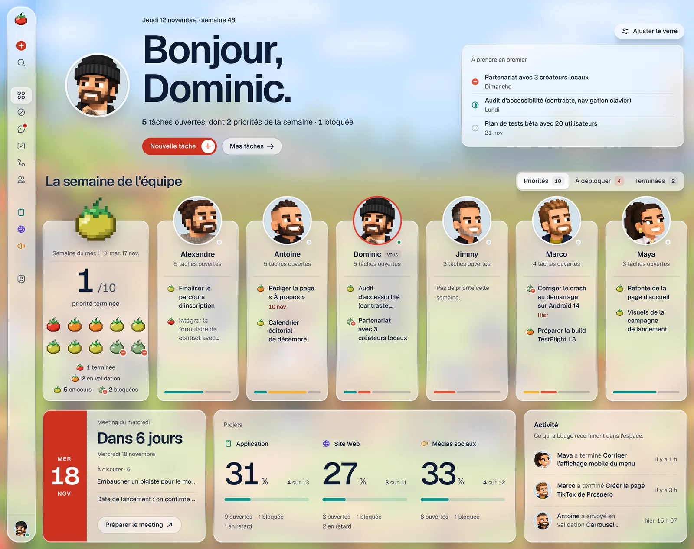

# Team Tomate HQ

Le QG de l'équipe Prospero : nos projets, qui fait quoi, et le **meeting du mercredi** — dans un seul outil, simple et rapide.



## Ce que fait l'application

| | |
|---|---|
| **Dashboard** | L'état des projets en 30 secondes, dans un bento de tuiles de verre : ce qui vous attend et le prochain meeting, 4 chiffres pour l'équipe et le rythme des tâches créées et terminées, priorités de la semaine, activité récente, une tuile par projet. |
| **Projets** | Un tableau structuré (façon Monday) et un kanban (façon Linear) sur les mêmes données : édition en ligne, glisser-déposer, filtres, tri, archivage. |
| **Tâches** | Responsable, statut, priorité, échéance, description, sous-tâches, commentaires et historique des changements. Une tâche terminée fait tomber une petite averse de tomates. |
| **Mes tâches** | La vue du matin : mes priorités, en retard, en cours, à venir, complétées récemment. |
| **Messages** | Le canal « Général » pour toute l'équipe et des conversations directes à deux : temps réel, non-lus, recherche, émojis, suppression de ses propres messages. |
| **Meeting du mercredi** | Préparation automatique → mode réunion en direct → récapitulatif figé → historique. |
| **Workflows** | Un canevas pour dessiner les processus de l'équipe : déclencheurs, étapes, agents IA, validations, livraisons. Enregistrement automatique, partagé en temps réel. |
| **Équipe** | Les partenaires, leur portrait en pixel art et la charge de chacun. |
| **Paramètres** | Réservé aux administrateurs : tableau des membres, recherche, invitations, rôles, activation des comptes. |
| **Navigation** | Un rail d'icônes en verre qui s'ouvre sous la souris et se referme quand elle repart ; une épingle (`⌘B`) le garde ouvert. Sur téléphone, un bouton de menu ouvre la navigation en plein écran. |
| **Apparence** | Du verre poli (celui de Koloc Cloud) posé sur une image de l'équipe, et un contenu sobre par-dessus. À l'arrivée, on voit d'abord l'image avec la tomate qui saute, puis l'application apparaît dessus. Chacun règle sa matière avec « Ajuster le verre » : la scène (la ferme ou le yacht), le flou, l'opacité, la saturation, le reflet des bords et la teinte. |

La semaine de travail va **du mercredi au mardi**. Les priorités de la semaine sont celles choisies au dernier meeting.

Raccourcis : `C` nouvelle tâche · `⌘K` / `Ctrl K` recherche · clic sur le glyphe de statut pour le changer · clic droit sur une tâche pour le menu contextuel · double-clic sur un titre pour le renommer.

## Démarrer en 1 minute (mode démo)

```bash
npm install
```

```bash
npm run dev
```

Ouvrez http://localhost:3000. Sans configuration Supabase, l'application démarre en **mode démo** : des données réalistes, enregistrées dans le navigateur, synchronisées entre les onglets. Le menu en bas à gauche permet de changer de profil et de réinitialiser la démo. Aucune de ces données fictives n'existe en production.

## Passer en production (Supabase)

Avec les deux variables ci-dessous, l'application utilise Supabase : Postgres pour les données, Auth pour la connexion, Realtime pour la synchronisation entre partenaires.

1. **Créer un projet Supabase dédié** à l'outil interne (ne pas réutiliser la base du site public).
2. **Appliquer le schéma** — tables, règles de sécurité, déclencheurs et les trois projets (Application, Site Web, Médias sociaux) :

   ```bash
   npx supabase link --project-ref <ref-du-projet>
   ```

   ```bash
   npx supabase db push
   ```

   (ou coller les fichiers de `supabase/migrations/`, dans l'ordre, dans l'éditeur SQL).
3. **Authentication → URL Configuration** : `Site URL` = l'adresse de l'application ; ajouter `https://<votre-domaine>/auth/callback` aux *Redirect URLs*.
4. **Variables d'environnement** (voir `.env.example`) :

   ```
   NEXT_PUBLIC_SUPABASE_URL=https://<ref>.supabase.co
   NEXT_PUBLIC_SUPABASE_PUBLISHABLE_KEY=sb_publishable_…
   ```
5. **Première connexion** : la première personne qui se connecte devient administratrice. Elle invite les autres depuis **Paramètres → Membres** (par courriel). Une personne non invitée peut créer un compte, mais reste « en attente » et ne voit rien tant qu'un administrateur ne l'active pas.
6. **Déployer** sur Vercel (ou tout hébergeur Node) avec ces deux variables.

La connexion se fait par lien magique envoyé par courriel, ou par mot de passe si vous en définissez dans Supabase. Pour un usage régulier, configurez un fournisseur SMTP dans Supabase (l'envoi intégré est limité).

## Développer avec Supabase en local

Prérequis : Docker.

```bash
npm run db:start
```

```bash
npm run db:reset
```

```bash
npm run seed:local
```

`db:reset` applique les migrations et crée six comptes de démonstration ; `seed:local` ajoute les tâches, meetings, workflows et messages de démo (le script refuse toute base qui n'est pas locale). Les données sont datées par rapport à l'heure de la machine : si elle est en UTC, lancez-le dans le fuseau de l'équipe, par exemple `TZ=America/Toronto npm run seed:local`. Copiez ensuite dans `.env.local` l'URL et les clés affichées par `npx supabase status`, puis `npm run dev`.

Comptes locaux : `dominic@prospero.test` (admin), `alexandre@`, `maya@`, `marco@`, `antoine@`, `jimmy@prospero.test` — mot de passe `tomate-demo`. Ce sont des adresses de test (domaine réservé), pas de vraies boîtes. Les courriels (liens magiques) arrivent dans Mailpit : http://127.0.0.1:54324.

Si les styles semblent périmés après un redémarrage de `npm run dev`, supprimez le cache de développement :

```bash
rm -rf .next/dev
```

## Scripts

| Commande | Rôle |
|---|---|
| `npm run dev` / `build` / `start` | Next.js |
| `npm run lint` / `typecheck` | ESLint, TypeScript |
| `npm run test:e2e` | Tests Playwright de bout en bout, en mode démo (`npx playwright install chromium` la première fois) |
| `npm run db:start` / `db:stop` / `db:reset` | Supabase local |
| `npm run db:test` | Tests pgTAP du schéma et des règles de sécurité |
| `npm run seed:local` | Données de démonstration dans la base **locale** |

## Architecture

Next.js 16 (App Router) · React 19 · TypeScript · Tailwind CSS 4 · shadcn/ui (Radix) · Zustand · dnd-kit · React Flow · Motion · Supabase.

```
src/
  app/                      routes (pages minces : elles montent un composant)
    (app)/                  espace connecté : /, /mes-taches, /messages, /meeting, /workflows, /projets/[slug], /equipe, /parametres
    login/, auth/callback/  connexion (lien magique, mot de passe)
  proxy.ts                  session Supabase + redirection vers /login
  lib/
    types.ts                modèle de données (identique aux colonnes Postgres)
    constants.ts            statuts, priorités, couleurs
    dates.ts                semaine mercredi → mardi, formats
    selectors.ts            dérivations pures : indicateurs, seaux du meeting, récapitulatif
    task-logic.ts           règles partagées client / démo (miroir des déclencheurs SQL)
    glass.ts                réglages du verre (préréglages, arrière-plans)
    chat.ts, chat-hooks.ts  règles de la messagerie (non-lus, regroupement du fil) et leurs hooks
    avatars.ts              portraits de l'équipe (attribués par le nom)
    workflow-apps.ts        pile d'actions du canevas de workflows
    store.ts                état global + actions optimistes
    data/                   frontière de persistance
      adapter.ts            interface commune
      supabase-adapter.ts   Postgres + Realtime + présence
      demo-adapter.ts       base locale (localStorage + BroadcastChannel)
      seed.ts               données de démonstration
  components/
    ui/                     primitives shadcn, et les composants repris des références : bouton « arrow fill »,
                            barre latérale, bouton de menu, infobulle animée, carte de connexion, tableau, canevas React Flow
    kit/                    design system maison : tomate et lettrage pixel, glyphes de statut, filet d'avancement, avatars, sélecteurs
    app/                    coquille en verre : navigation (bureau et téléphone), recherche, réglages du verre, préchargeur, averse de tomates
    tasks/                  ligne de tâche, panneau de détail, menus, création rapide
    board/                  tableau, kanban, filtres, glisser-déposer
    workflows/              liste, éditeur et enregistrement des canevas
    dashboard/ my-tasks/ meeting/ team/ auth/
    settings/               paramètres des administrateurs (membres)
    chat/                   messages : conversations, fil, saisie
public/backgrounds/         les deux scènes derrière le verre (la ferme, le yacht)
public/avatars/             portraits de l'équipe (carrés de 256 px)
scripts/
  seed-local.ts             données de démonstration pour la base locale
supabase/
  migrations/               schéma, RLS, déclencheurs
  tests/database/           tests pgTAP
  seed.sql                  comptes de démo (local uniquement)
e2e/                        tests Playwright
```

**Flux de données.** L'interface ne parle jamais directement à Supabase : elle appelle une action du store, qui applique le changement tout de suite à l'écran (optimiste), le persiste par l'adaptateur, puis fusionne les changements des autres membres reçus en temps réel. En cas d'échec, l'écran revient à l'état précédent avec un message. Le mode démo et le mode Supabase partagent exactement la même interface.

**Ajouter un projet** : bouton « + » dans la navigation — aucun code. **Ajouter le portrait d'un nouveau membre** : déposer `prenom-nom.webp` dans `public/avatars/` et ajouter une ligne dans `lib/avatars.ts` ; le portrait est attribué par le nom du profil, sans égard aux majuscules ni aux accents (le prénom seul suffit quand le profil n'a que lui, comme juste après une invitation). **Ajouter un statut ou une couleur** : `lib/constants.ts`, `lib/types.ts` et la contrainte correspondante dans une nouvelle migration. **Ajouter un outil à la pile des workflows** : `lib/workflow-apps.ts`.

## Sécurité

- Chaque table a la *Row Level Security* activée ; le rôle anonyme n'a aucun droit.
- Seuls les **membres actifs** lisent et modifient les données. Un compte non invité reste en attente.
- Les commentaires ne sont modifiables que par leur auteur ; l'historique (`task_events`) est écrit uniquement par des déclencheurs, jamais par le client.
- L'auteur et le dernier éditeur d'un workflow sont fixés par le serveur.
- Messages : une conversation directe n'est lisible que par ses deux membres, y compris par le temps réel, et un client ne peut pas en créer une entre deux autres personnes. On écrit sous son propre nom, à l'heure du serveur ; un message ne se modifie pas, seul son auteur peut le supprimer.
- Un membre ne peut changer que son propre profil ; rôles et accès sont réservés aux administrateurs, et il reste toujours au moins un administrateur.
- Seule la clé *publishable* est exposée au navigateur. En-têtes de sécurité de base dans `next.config.ts`.

## Vérifié

- `npm run lint`, `npm run typecheck`, `npm run build` : sans erreur ni avertissement.
- `npm run db:test` : 139 assertions pgTAP (droits, RLS, déclencheurs, invitations, workflows, messagerie).
- `npm run test:e2e` : 38 scénarios en mode démo — tableau, kanban, filtres et archivage, raccourcis et panneau de tâche, synchronisation entre onglets, meeting complet, workflows, réglages du verre, navigation (survol, épingle, téléphone), connexion, paramètres des membres, messagerie (écrans et règles), portraits, averse de tomates, arrivée sur la scène et bento régulier du dashboard.
- Contre une instance Supabase locale : connexion par mot de passe et par lien magique, persistance en base, propagation en temps réel entre deux navigateurs (statut, commentaire, glisser-déposer, meeting en direct, canevas de workflow), présence, compte non invité bloqué puis activé depuis les paramètres, déconnexion ; messagerie à trois comptes (livraison en direct, conversation directe invisible pour un tiers dans l'interface, le temps réel et l'API, lecture persistée, suppression propagée).

## Limites connues du MVP

- Pas de pièces jointes, de notifications par courriel ni d'intégrations externes — volontairement. La messagerie est du texte : pas de fichiers, de fils de réponses, de mentions ni de modification d'un message envoyé. Chaque conversation charge ses 100 derniers messages, les précédents à la demande. Les étapes d'un workflow décrivent un processus ; elles ne déclenchent rien.
- Les portraits sont livrés avec l'application et attribués par le nom : il n'y a pas d'envoi de photo depuis le profil.
- Un workflow est enregistré d'un bloc : si deux personnes modifient le même canevas au même instant, la dernière sauvegarde l'emporte.
- L'espace entier est chargé en mémoire au démarrage : parfait pour une petite équipe (quelques milliers de tâches), à paginer au-delà.
- Les dates « jour » (échéances, début de semaine) suivent le fuseau horaire du navigateur : l'équipe est supposée partager le même fuseau.
- L'étape affichée en mode réunion et les réglages du verre sont propres à chaque navigateur.

## Crédits

- Arrière-plans : « La ferme » et « Le yacht » sont fournis par l'équipe, servis depuis `public/backgrounds/`.
- Verre : la recette « verre poli » vient de Koloc Cloud (`ui/verre.css`), portée sur les variables réglables de cette application.
- Canevas de workflows : adapté du composant « interactive-workflow-blueprint » (21st.dev), construit sur [React Flow](https://reactflow.dev).
- Composants adaptés de références publiées sur 21st.dev : le principe du verre réglable (« adjustable glass dashboard »), la barre latérale (Wensity), le bouton de menu (Origin UI), le bouton « arrow fill » (Hyperiux Vault), l'infobulle animée (Aceternity UI), la carte de connexion (« sign-in card 2 »), le fil d'activité (« activity 1 »), le tableau des membres (« members 02 ») et la messagerie (« chat template »). Le détail est dans [docs/DESIGN.md](docs/DESIGN.md#références-reprises). Animations : [Motion](https://motion.dev) (framer-motion).
- Logo et lettrage : tomate et alphabet en pixel art dessinés pour le projet (`components/kit/pixel-tomato.tsx`, `pixel-text.tsx`).
- Portraits : fournis par l'équipe, recadrés en carrés de 256 px (`public/avatars/`).

Voir aussi : [architecture UX/UI, structure des écrans et design system](docs/DESIGN.md).
