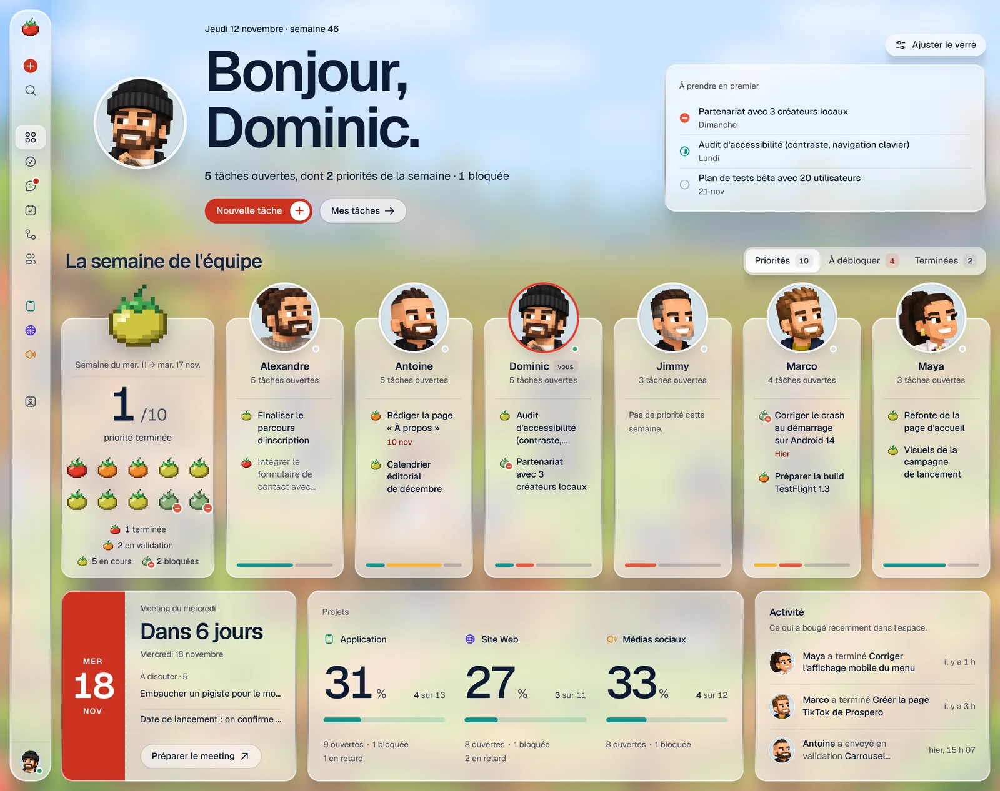
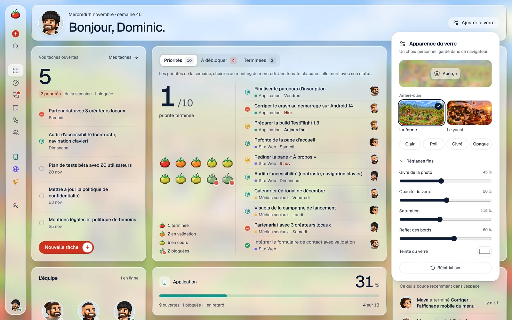

# Architecture UX/UI et design system

Ce document décrit *pourquoi* l'interface est construite ainsi : les principes, la structure des écrans, les règles métier visibles, puis le design system.

## 1. Principes

| Principe | Ce que ça donne concrètement |
|---|---|
| **Simplicité** | Sept écrans, une navigation à trois sections. Une seule façon de faire chaque chose. |
| **Clarté** | Chaque tâche montre toujours les mêmes informations, au même endroit. Avatar = qui. Glyphe = où ça en est. Étoile jaune = priorité de la semaine. |
| **Efficacité** | Créer et assigner une tâche : un titre, `Entrée`. Chaque propriété se modifie là où elle s'affiche, en un clic. `C` crée, `⌘K` trouve. |
| **Minimalisme** | Du texte, des filets, de l'air. Presque monochrome : l'encre, des gris, et une seule couleur d'accent. Pas de halo, de dégradé, d'icône dans une pastille ni de capsule colorée. Une information n'apparaît qu'une fois par écran. |

Ce qui a été volontairement laissé de côté : étiquettes, dépendances, estimation, automatisations réelles, vues personnalisées, graphiques.

## 2. Structure des écrans

```
Vue d'ensemble                    Projets                 Équipe
├─ Dashboard        /             ├─ Application          └─ Membres   /equipe
├─ Mes tâches       /mes-taches   ├─ Site Web
├─ Meeting          /meeting      └─ Médias sociaux       /projets/<slug>
│  └─ Récapitulatif /meeting/<id>    (+ nouveaux projets)
└─ Workflows        /workflows
   └─ Canevas       /workflows/<id>
```

Le panneau de détail d'une tâche, la création rapide, la recherche et « Ajuster le verre » sont des calques globaux : on les ouvre depuis n'importe quel écran sans perdre sa place.

### Dashboard — « où en est-on ? »

Pas de boîtes : des sections posées à plat, séparées par un filet.

1. **Une phrase** : la salutation, puis ce qui attend la personne (tâches ouvertes, priorités, retards).
2. **Quatre chiffres** : à compléter · en cours · bloquées ou en retard · complétées cette semaine. Ils parlent de l'équipe ; la phrase parle de soi.
3. **Priorités de la semaine** : statut (le glyphe se clique pour le changer), titre, projet, échéance, responsable.
4. **Meeting du mercredi** : la date, trois faits, un bouton.
5. **Projets** : un filet d'avancement par projet.
6. **Activité récente** : un journal, une ligne par événement.



### Projet — tableau et kanban

Un même jeu de données, deux lectures. Les filtres, le tri et le glisser-déposer sont partagés : une tâche modifiée dans une vue l'est dans l'autre.

- **Tableau** (inspiration Monday) : groupes par statut, colonnes Tâche · Responsable · Statut · Priorité · Échéance, chaque cellule éditable sur place, ligne « Ajouter une tâche » au pied de chaque groupe, poignée de réorganisation au survol.
- **Kanban** (inspiration Linear) : une colonne par statut, cartes compactes, déplacement par glisser-déposer.
- **Barre d'outils** : bascule de vue · avatars cliquables pour filtrer par responsable · filtre statut/priorité · recherche · tri (manuel, échéance, priorité) · tâches archivées.


### Détail d'une tâche

Panneau latéral : titre, cinq propriétés, description, sous-tâches, puis un fil unique qui mêle commentaires et historique des changements. Le champ de commentaire reste accessible en bas.


### Mes tâches — la vue du matin

Sections dans l'ordre de l'attention : priorités de la semaine → en retard → en cours → à venir → complétées récemment. Une tâche n'apparaît qu'une fois, dans la première section qui la concerne. On peut consulter la vue d'un autre partenaire.


### Meeting du mercredi — le rituel

Trois états, un seul écran.

**Avant.** Un titre, un bouton. L'application prépare la rencontre toute seule : complétées depuis mercredi dernier · à valider ensemble · bloquées · en retard · sans progrès. Chacun peut noter des *points à discuter* pendant la semaine.


**Pendant.** « Démarrer le meeting » ouvre le mode réunion pour tout le monde, en temps réel. Une barre sombre porte le chronomètre et les étapes : tour d'horizon → un projet à la fois → priorités → clôture. Dans chaque projet, une ligne d'ajout permet de créer une tâche et de l'assigner d'un clic sur un avatar, sans quitter le meeting. L'étoile marque les priorités. À droite, toujours visibles : points à discuter et décisions prises.


L'étape **Priorités** est une seule liste, groupée par personne. Elle rappelle les priorités de la semaine précédente restées ouvertes, à reconduire d'un clic.


**Après.** La clôture enregistre un récapitulatif figé, présenté comme un compte rendu sur une seule feuille : priorités par responsable, nouvelles tâches, accompli, décisions, points reportés. Il rejoint l'historique et se copie en texte simple pour un courriel.


### Workflows — dessiner un processus

Une liste de canevas, chacun avec son aperçu miniature, puis un éditeur.

- **Étapes** de cinq natures : déclencheur, agent IA, intégration, validation, livraison — chacune avec son nom, ce qu'elle fait et l'outil concerné. Le canevas est en un seul ton : les natures se distinguent par leur glyphe.
- **Pile d'actions** à droite : les outils de l'équipe. Un clic ajoute l'action après l'étape sélectionnée et la relie.
- **Liens** par glisser d'un port à l'autre ; les boucles et les doublons sont refusés. Un formulaire replié permet de tout faire au clavier.
- **Enregistrement automatique** une demi-seconde après chaque modification, et à la sortie de la page. Les modifications d'un coéquipier arrivent en direct. L'export JSON est dans le menu « … » de la page.

Un workflow décrit un processus ; il ne déclenche aucune action réelle.


### Mobile

La navigation devient un tiroir (un bouton « + » reste dans l'en-tête), les quatre chiffres passent en grille 2 × 2, le tableau ne garde que le titre, le statut et le responsable, le kanban défile horizontalement. Les titres passent sur deux lignes plutôt que d'être tronqués. Les lignes de tâche s'adaptent à la largeur de leur conteneur (et non de l'écran).


## 3. Règles métier visibles

- **Semaine** : du mercredi 00 h au mardi soir (`lib/dates.ts`).
- **Priorités de la semaine** : elles appartiennent à un meeting. L'étoile modifie celles du meeting en cours, sinon du dernier meeting tenu. Le dashboard affiche celles du dernier meeting tenu, puis celles du meeting en cours dès qu'il en définit.
- **Sans progrès** : tâche ouverte dont le statut n'a pas changé depuis le début du meeting précédent.
- **En retard** : échéance passée et tâche non terminée.
- **Progression d'un projet** : tâches terminées (archivées comprises) ÷ toutes les tâches.
- **Récapitulatif** : calculé en direct pendant le meeting, figé à la clôture. L'historique ne bouge plus, même si les tâches changent ensuite.
- **Points à discuter** non traités : ils réapparaissent au meeting suivant avec la mention « Reporté ».
- **Workflow** : enregistré d'un bloc ; en cas de modification simultanée, la dernière sauvegarde l'emporte.

Ces règles vivent dans `lib/selectors.ts` (fonctions pures), pour que chaque écran raconte la même histoire.

## 4. Design system

Références : Linear pour la sobriété et les interactions, Things pour le calme, Monday pour la structure des tâches. Les jetons sont déclarés dans `src/app/globals.css`.

### Le parti pris

Une interface de travail presque monochrome, sur un fond de papier. La seule fantaisie est la tomate en pixel art : elle est le logo, elle rebondit au chargement, et elle mûrit à côté des priorités de la semaine. Tout le reste est du texte, des filets et de l'espace.

| Élément de marque | Où | Règle |
|---|---|---|
| **Tomate** (`kit/pixel-tomato.tsx`) | Logo, préchargeur, connexion, à côté de « Priorités de la semaine » | Grille 16 × 16, dessinée en code, tailles multiples de 16. À côté des priorités, elle **mûrit** en quatre étapes (verte → tournante → orangée → rouge) à mesure qu'elles se terminent. |
| **Lettrage pixel** (`kit/pixel-text.tsx`) | Le nom, sur l'écran de connexion seulement | Alphabet 5 × 7 dessiné pixel par pixel. Jamais dans l'espace de travail. |


### Surfaces

| Couche | Rôle |
|---|---|
| **Fond** | Par défaut, un papier chaud et uni. |
| **Feuilles** (`.gw-glass`) | La navigation et la fenêtre principale : deux feuilles claires, coins arrondis, à peine détachées du fond. |
| **Contenu** | Posé directement sur la feuille. Les listes d'un même écran sont séparées par un filet, pas enfermées dans des cartes. |
| **Panneaux** (`.card-surface`) | Là où un groupe doit se lire comme un objet (groupes du tableau, listes du meeting, cartes du kanban) : un fond blanc et un filet, sans ombre. |
| **Sombre** | Réservé à la barre du meeting en direct : le sombre veut dire « en direct ». |

Les feuilles sont en verre : « Ajuster le verre » (en bas de la navigation) permet de choisir un arrière-plan — un paysage en pixel art, « Potager », ou trois photos — et de rendre les feuilles plus ou moins translucides, avec trois préréglages (Clair, Givré, Opaque) et des réglages fins repliés. Le choix est propre à chaque navigateur. L'en-tête de page et la barre du meeting floutent le contenu qui défile dessous.

Règle technique : deux surfaces floutées ne s'emboîtent jamais — un flou imbriqué est ignoré par Chrome. Le givre de la fenêtre est donc un calque à part, placé derrière la zone de défilement.



### Couleurs

| Rôle | Jeton | Valeur | Usage |
|---|---|---|---|
| Encre | `navy-900` | `#0D1B33` | Texte, boutons, filets d'avancement |
| Gris | `navy-300` à `navy-600` | — | Texte secondaire, icônes, bordures. Peu saturés : le texte secondaire est gris, pas bleu. |
| Papier | `--background` | `#F2F0EB` | Le fond |
| Tomate | `tomato-600` | `#CC3320` | **Créer une tâche** — une seule fois par écran — et le bouton de connexion |
| Statuts | teal, jaune, corail, vert | — | Uniquement dans les glyphes de statut, l'étoile des priorités et les alertes (retard, blocage) |

Les couleurs d'identification (membres, projets) restent discrètes : une pastille pâle avec des initiales, une petite icône au trait.

**Statuts** — un glyphe par statut (`kit/status-icon.tsx`), un anneau qui se remplit à mesure que le travail avance. Le glyphe porte la couleur, le libellé reste en encre.

| À faire | En cours | En validation | Bloqué | Terminé |
|---|---|---|---|---|
| anneau gris | demi-anneau teal | trois quarts jaune | disque corail barré | disque vert coché |

**Priorités** — barres de signal : trois (Haute, corail), deux (Normale), une (Basse).

### Typographie

Geist Sans. Chiffres tabulaires pour les compteurs et les dates. Une échelle courte, sans demi-tailles, en casse normale :

| Usage | Taille |
|---|---|
| Phrase d'accueil, grands chiffres | 22 – 28 px |
| Titre de page, de groupe | 15 px, 600 |
| Corps, lignes de tâche, contrôles, titres de section | 13 px (14 px dans les formulaires) |
| Métadonnées | 12 px |
| Compteurs, raccourcis | 11 px |

### Forme et mouvement

- **Rayons** : 7 px (petits contrôles), 10 px (lignes, boutons), 13 px (panneaux), 20 px (feuilles).
- **Séparations** : des filets à 9 % d'encre. Pas d'ombre portée sur les panneaux, aucune lueur.
- **Avancement** : un filet de 3 px, encre sur gris (`kit/progress.tsx`).
- **Défilement** : seule la fenêtre principale défile.
- **Mouvement** : les sections arrivent par un fondu de 300 ms ; la coche et l'étoile « rebondissent » une fois ; la carte glissée se soulève. Au chargement, la tomate tombe, rebondit et fait une pirouette un saut sur deux, en CSS pur. Tout est neutralisé avec `prefers-reduced-motion`.

### Composants

| Dossier | Contenu |
|---|---|
| `components/ui` | Primitives shadcn/Radix restylées avec les jetons, et le canevas de workflows |
| `components/kit` | Briques de l'application : `PixelTomato`, `PixelText`, `ProgressLine`, `StatusIcon`, `StatusLabel`, `PriorityIcon`, `MemberAvatar`, `DueLabel`, `PriorityStar`, `TaskCheck`, sélecteurs, `EmptyState` |
| `components/app` | Coquille : `GlassBackdrop`, `GlassSettingsButton`, `Preloader`, navigation, recherche |
| `components/tasks` | `TaskLine` (ligne compacte réutilisée partout), `TaskSheet`, menus contextuels, `QuickAdd` |
| `components/dashboard` | `Section` (une section à plat) et ses contenus |

Règle de composition : une information = un composant, réutilisé partout. Le statut d'une tâche a la même apparence dans le tableau, le kanban, le dashboard et le meeting.

### Accessibilité

Navigation complète au clavier, focus visible (anneau teal), libellés pour les boutons-icônes, zones tactiles confortables sur mobile, états jamais portés par la couleur seule (glyphe + libellé). Le filet d'avancement et la tomate qui mûrit ont un équivalent textuel. Le texte respecte un contraste AA avec les réglages par défaut ; avec un arrière-plan en image et le préréglage « Clair », le contraste dépend de l'image — « Opaque » le garantit en toutes circonstances.
