# Architecture UX/UI et design system

Ce document décrit *pourquoi* l'interface est construite ainsi : les principes, la structure des écrans, les règles métier visibles, puis le design system.

## 1. Principes

| Principe | Ce que ça donne concrètement |
|---|---|
| **Simplicité** | Huit écrans, une navigation à trois sections. Une seule façon de faire chaque chose. |
| **Clarté** | Chaque tâche montre toujours les mêmes informations, au même endroit. Avatar = qui. Glyphe = où ça en est. Étoile jaune = priorité de la semaine. |
| **Efficacité** | Créer et assigner une tâche : un titre, `Entrée`. Chaque propriété se modifie là où elle s'affiche, en un clic. `C` crée, `⌘K` trouve. |
| **Minimalisme** | Du texte, des filets, de l'air. Le contenu est presque monochrome : l'encre, des gris, et très peu de couleur. La matière, elle, est du verre posé sur un paysage : c'est lui qui donne la couleur, pas des aplats ni des capsules. Une information n'apparaît qu'une fois par écran. |

Ce qui a été volontairement laissé de côté : étiquettes, dépendances, estimation, automatisations réelles, vues personnalisées, tableaux de bord de graphiques (un seul petit graphique, sur le dashboard : les tâches terminées par semaine).

## 2. Structure des écrans

```
Espace de travail                    Projets                 Paramètres
├─ Dashboard        /                ├─ Application          ├─ Apparence      /parametres?section=apparence
├─ Mes tâches       /mes-taches      ├─ Site Web             ├─ Compte         /parametres?section=compte
├─ Messages         /messages        └─ Médias sociaux       ├─ Notifications  /parametres?section=notifications
│  └─ Conversation  /messages/<id>      /projets/<slug>      └─ Membres        /parametres?section=membres (administrateurs)
├─ Meeting          /meeting
│  └─ Récapitulatif /meeting/<id>
├─ Workflows        /workflows
│  └─ Canevas       /workflows/<id>
├─ Équipe           /equipe
└─ Arcade
   └─ Tomato Tower  /arcade
```

Le panneau de détail d'une tâche, la création rapide et la recherche sont des calques globaux : on les ouvre depuis n'importe quel écran sans perdre sa place.

### Navigation — un rail qui s'ouvre sous la souris

Au repos, la navigation est un rail d'icônes : le contenu a toute la place. On approche la souris, elle s'ouvre par-dessus le contenu avec ses libellés, ses compteurs et les projets ; on choisit, elle se replie. L'épingle en haut à droite (ou `⌘B`) la garde ouverte pour qui préfère l'avoir sous les yeux. Le détail du comportement est dans [Forme et mouvement](#forme-et-mouvement).

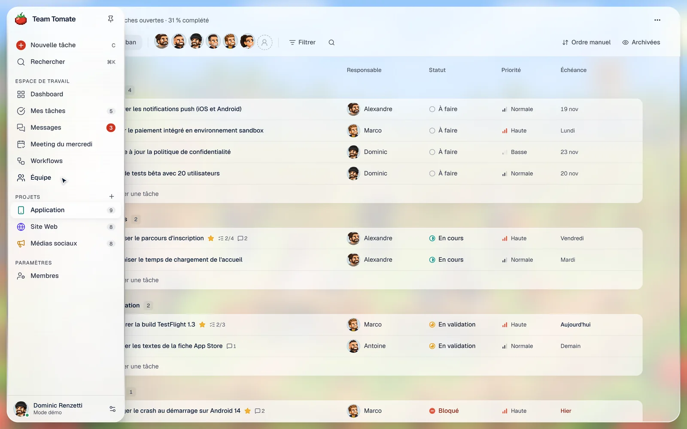

### Dashboard — « où en est-on ? »

Une page en **trois bandes qui ne se ressemblent pas**, posée directement sur l'image : pas de feuille derrière elle, jamais de verre sur du verre. La version d'avant était un mur de tuiles : chaque section était une boîte contenant une liste, tout parlait sur le même ton, et rien ne disait par où commencer. Ici chaque bande a sa forme : une phrase, puis des gens, puis trois objets. La page occupe toute la zone à côté de la navigation et s'aligne sur elle : même haut, même bas, et le même écart de 14 px que la fenêtre des autres écrans. Sur un écran haut, la salutation et le pied se partagent la place qui reste ; sur un écran plus court, la page défile sous une navigation qui ne bouge pas.

1. **La salutation**, écrite sur l'image, sans tuile : « Bonjour, Dominic. » en très grand (jusqu'à 112 px, sur deux lignes serrées), à côté d'un grand portrait. La page s'ouvre sur une phrase, pas sur une boîte. Au-dessus, la date et la semaine ; en dessous, où j'en suis, en une ligne (« **5** tâches ouvertes, dont **2** priorités de la semaine · **1** bloquée »), puis **Nouvelle tâche**, l'action principale de la page, et le chemin vers **Mes tâches**. À droite, « À prendre en premier » : mes trois prochaines tâches (les priorités, puis les retards, puis ce qui est en cours), en **trois billets numérotés** plutôt qu'en liste dans une boîte. Le premier est celui à prendre maintenant : plus haut, son numéro sur une souche tomate, comme la date du billet du meeting au pied de la page ; les deux suivants sont plus minces, leur numéro sur le verre. Chaque billet dit le statut (un mot, qui est aussi la commande pour le changer), le projet, l'échéance et l'étoile d'une priorité de la semaine ; il ouvre sa tâche d'un clic. Une brume blanche derrière la bande, qui s'efface vers le bas et vers la navigation, garde les petites lignes lisibles sur les deux images. L'idée vient du tableau de bord de Koloc Cloud : une salutation typographique à côté d'un portrait plutôt qu'une tuile de plus.
2. **La semaine de l'équipe**, en alignement : d'abord **la tomate de la semaine** (aussi mûre que la semaine est avancée ; sa carte porte le score), puis **une carte par partenaire**. Chaque tête — la tomate, un visage — dépasse de moitié au-dessus de sa carte ; la mienne est cerclée de tomate. Sous le prénom et le nombre de tâches ouvertes, ce que la vue choisie contient pour la personne ; au pied, sa **barre de charge** : un segment par statut de ses tâches ouvertes (en cours, en validation, bloquée, à faire), que le survol nomme. Un visage mène aux tâches de la personne ; une tâche s'ouvre d'un clic.

   **Trois onglets** changent ce que montrent toutes les cartes à la fois. Chacun porte son compte : la page les dit donc sans un clic.
   - **Priorités** : le score en très grand (« 1/10 »), puis le **potager** : une tomate par priorité, qui mûrit avec son statut (verte à faire, tournante en cours, orangée en validation, rouge terminée ; pâlie et marquée du glyphe « bloqué » quand elle n'avance plus), rangées de la plus mûre à la plus verte, ce qui en fait aussi une barre d'avancement. Chaque tomate est un bouton qui ouvre sa tâche. Sur chaque carte, les priorités de la personne, chacune avec sa tomate.
   - **À débloquer** : le nombre de tâches bloquées ou en retard dans toute l'équipe (le seul chiffre en rouge de la page : c'est celui qui demande quelque chose), ce dont il est fait, et à qui ça revient.
   - **Terminées** : le chiffre de la semaine, celui de la semaine dernière, une barre par semaine (de mercredi à mardi) sur six semaines, la semaine en cours en teal, et qui a terminé quoi.

   Les trois vues d'une carte sont posées l'une sur l'autre et une seule se voit : les cartes gardent la hauteur de la plus remplie, et la page ne saute pas quand on change d'onglet. Une carte montre au plus quatre tâches, puis un compte. Les tâches sans responsable ont leur propre carte, qui n'existe que s'il y en a.
3. **Le pied** : trois objets de formes différentes, qui commencent et finissent ensemble.
   - **Le meeting hebdomadaire est un billet** : sa date sur une souche tomate (un des deux aplats de couleur de la page, avec le numéro du premier billet « À prendre en premier »), puis dans combien de jours, les points à discuter, et l'entrée. Pendant un meeting le billet devient **sombre** (le sombre veut dire « en direct », ici comme sur la page du meeting) et montre l'horloge ; ensuite, « Terminé » et le chemin du récapitulatif.
   - **Les projets** sur une seule feuille, en colonnes : le pourcentage en grand, une barre, les comptes (ouvertes, bloquées, en retard, « 4 sur 13 »). Côte à côte, ils se comparent d'un coup d'œil ; une colonne ouvre son projet.
   - **L'activité** : qui a fait quoi, sur quelle tâche, et quand : un portrait, une phrase, l'heure. Elle montre autant d'événements entiers que sa hauteur le permet (`.gw-fit`) ; ceux qui n'ont pas la place sont aussi hors du parcours clavier et des lecteurs d'écran.

Quand la fenêtre est plus étroite, l'alignement passe sur plusieurs rangées (trois cartes de front, deux sur téléphone) sous la carte du score, qui prend alors toute la largeur, et le pied s'empile.

Les deux lignes de la salutation montent de sous un cache, l'une après l'autre ; les chiffres comptent depuis zéro quand leur carte arrive (et quand on change d'onglet), les tomates et les barres se posent l'une après l'autre, les barres des projets s'allongent. Rien de tout cela ne bouge avec « moins de mouvement ». Ce que montrent ces dessins existe aussi en mots : chaque tomate porte le titre, le statut et le responsable de sa tâche, chaque barre son compte, la barre de charge sa répartition, chaque projet « n tâches terminées sur m ». Les onglets sont de vrais onglets : les flèches passent de l'un à l'autre, et la vue qui n'est pas affichée est hors du parcours clavier et des lecteurs d'écran.


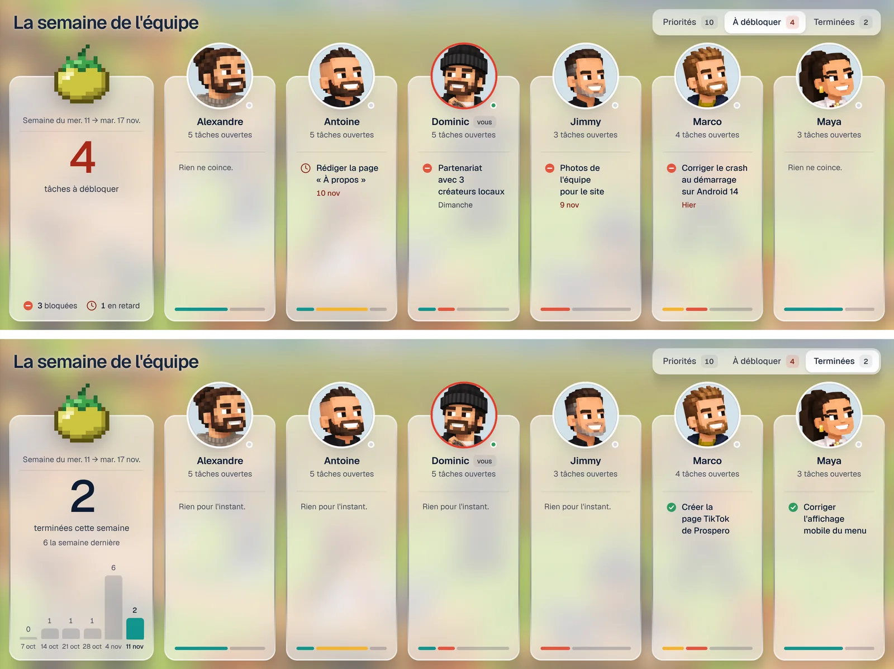

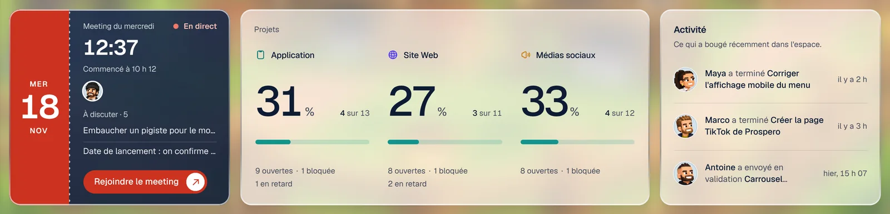

### Projet — tableau et kanban

Un même jeu de données, deux lectures. Les filtres, le tri et le glisser-déposer sont partagés : une tâche modifiée dans une vue l'est dans l'autre.

- **Tableau** (inspiration Monday) : groupes par statut, colonnes Tâche · Responsable · Statut · Priorité · Échéance, chaque cellule éditable sur place, ligne « Ajouter une tâche » au pied de chaque groupe, poignée de réorganisation au survol.
- **Kanban** (inspiration Linear) : une colonne par statut, cartes compactes, déplacement par glisser-déposer.
- **Barre d'outils** : bascule de vue · avatars cliquables pour filtrer par responsable · filtre statut/priorité · recherche · tri (manuel, échéance, priorité) · tâches archivées.

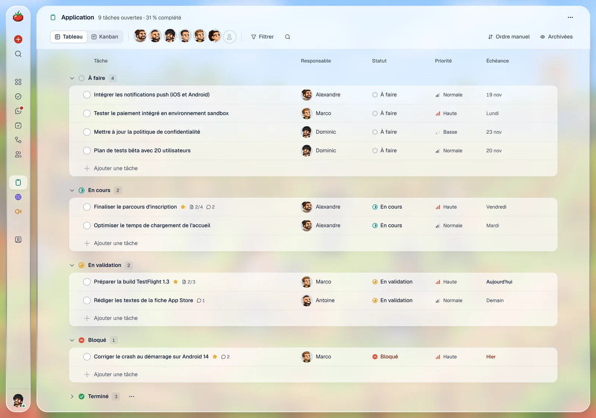
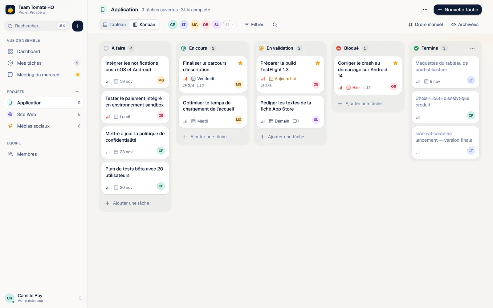

### Détail d'une tâche

Panneau latéral : titre, cinq propriétés, description, sous-tâches, fichiers, puis un fil unique qui mêle commentaires et historique des changements. Le champ de commentaire reste accessible en bas.

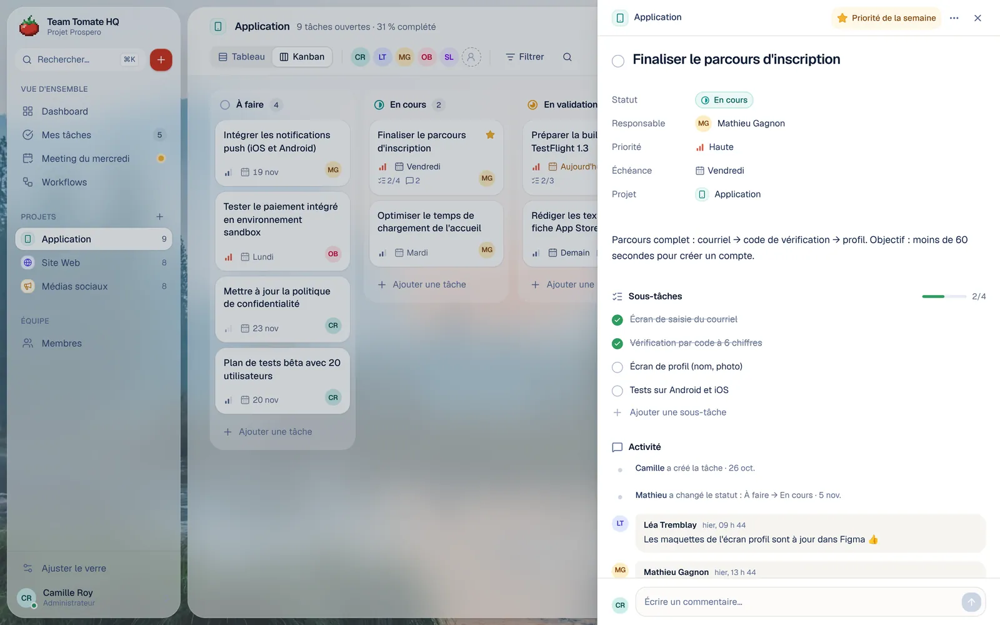

**Les fichiers.** Une tâche porte ses fichiers : photos, vidéos, documents, n'importe quoi jusqu'à 100 Mo. Trois façons d'en joindre, toutes au même endroit : « Ajouter » ouvre le sélecteur, un fichier lâché n'importe où sur le panneau est joint (le panneau le dit pendant qu'on le tient au-dessus), et une capture d'écran collée part dans les fichiers, pas dans le texte.

Chaque fichier est une tuile : une photo ou une vidéo par son image, le reste par un glyphe et son extension, puis le nom, le poids et qui l'a joint. Un fichier en cours d'envoi a déjà sa tuile, avec sa barre et un bouton pour l'arrêter ; deux envois avancent à la fois, les autres attendent. Si l'envoi échoue, la tuile dit pourquoi et propose de réessayer, sauf quand le stockage a refusé le fichier lui-même. Un fichier trop lourd est refusé avant tout envoi, avec son poids et la limite.

Ouvrir un fichier le montre en grand sans quitter la tâche : image, vidéo, son, PDF, texte court ; pour le reste, « Télécharger ». Les flèches passent d'un fichier au suivant. Retirer se confirme, puisque c'est pour toute l'équipe. Le nombre de fichiers figure sur la ligne de la tâche, à côté des sous-tâches et des commentaires, et l'historique dit qui a joint quoi.

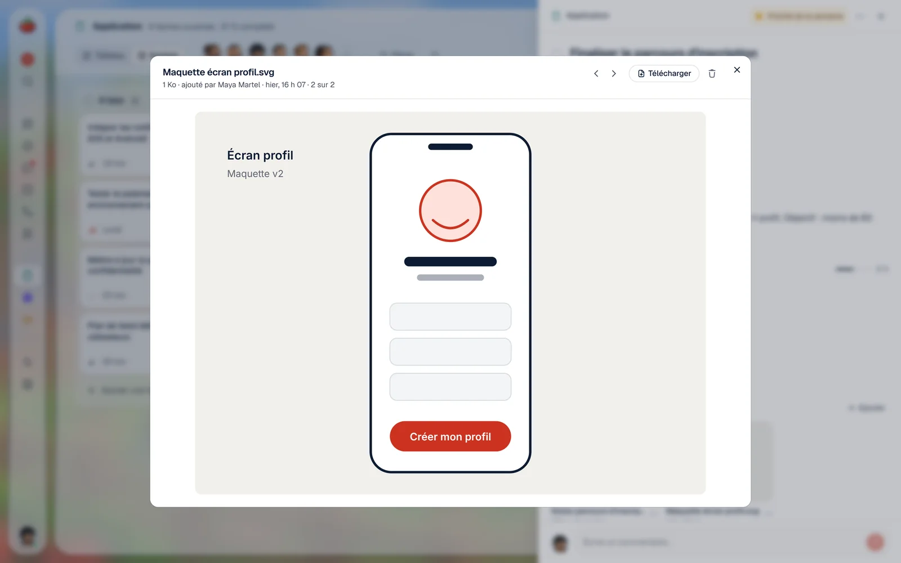

Côté technique : les octets vont dans un bucket privé de Supabase Storage, par envoi reprenable (protocole TUS, par parts de 6 Mo : une connexion qui tombe au milieu d'une vidéo reprend où elle en était). La ligne en base n'est écrite qu'une fois le fichier en lieu sûr. Pour une photo ou une vidéo, le navigateur fabrique d'abord une miniature de 480 px : la liste charge quelques kilo-octets, pas les fichiers. On ne lit un fichier que par une adresse signée, valable une heure. En mode démo, les octets restent dans le navigateur (IndexedDB).

### Mes tâches — la vue du matin

Sections dans l'ordre de l'attention : priorités de la semaine → en retard → en cours → à venir → complétées récemment. Une tâche n'apparaît qu'une fois, dans la première section qui la concerne. On peut consulter la vue d'un autre partenaire.

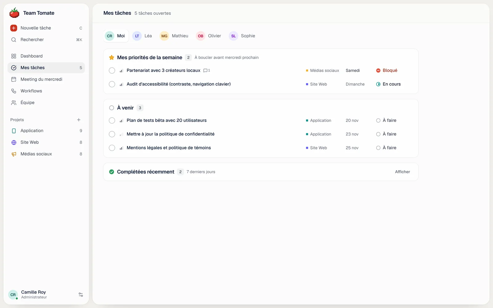

Terminer une tâche — ici ou ailleurs, par la coche, le statut ou une carte glissée dans « Terminé » — fait tomber une courte averse de tomates sur l'écran. Deux secondes, par-dessus tout, sans rien bloquer.

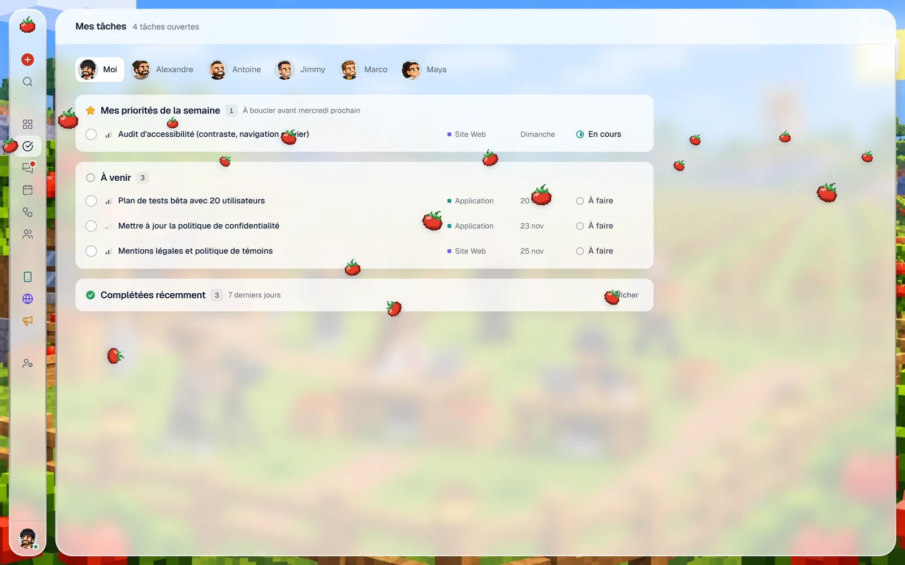

### Messages — se parler

Deux volets sur un grand écran : les conversations à gauche, le fil à droite.

- **Général**, le canal de toute l'équipe, puis les **messages directs** entre deux personnes, triés par dernière activité. Une recherche (sans égard aux accents) filtre la liste. « Nouveau message » ouvre la conversation avec la personne choisie, ou la crée.
- **Le fil** : séparateurs de jour, messages groupés par auteur (portrait et prénom une seule fois), les miens à droite en encre, ceux des autres sur du verre. Un trait « Nouveaux messages » marque l'endroit où je m'étais arrêté, et le fil s'ouvre là. Les adresses web sont des liens ; un message fait seulement d'émojis s'affiche en grand.
- **La saisie** : `Entrée` envoie, `Maj + Entrée` va à la ligne (sur un clavier tactile, `Entrée` va à la ligne et le bouton envoie). Une petite feuille d'émojis. Le brouillon de chaque conversation est gardé le temps de la visite.
- **Non-lus** : une pastille tomate sur la conversation et sur l'entrée « Messages » de la navigation (un point sur le rail). Lire, c'est avoir le fil à l'écran, la fin en vue, dans un onglet visible.
- **Supprimer** : seulement ses propres messages (survol, clic droit ou appui long). Le message reste à sa place, remplacé par « Message supprimé ».

Sur un téléphone, une vue à la fois : la liste, puis la conversation avec une flèche de retour.

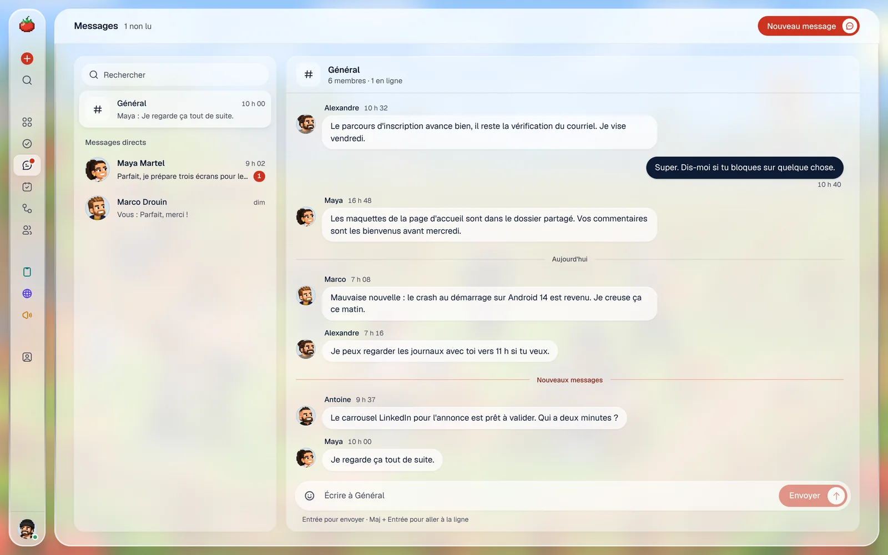

### Meeting hebdomadaire — le rituel

Trois états, un seul écran.

**Avant.** Un titre, un bouton, et « Comment ça marche ? » : les trois temps du meeting expliqués en quelques lignes (et la précision que rien n'est capté en audio ni en vidéo : « en direct » veut dire que le meeting est ouvert). L'application prépare la rencontre toute seule : complétées depuis mercredi dernier · à valider ensemble · bloquées · en retard · sans progrès. Chacun peut noter des *points à discuter* pendant la semaine.

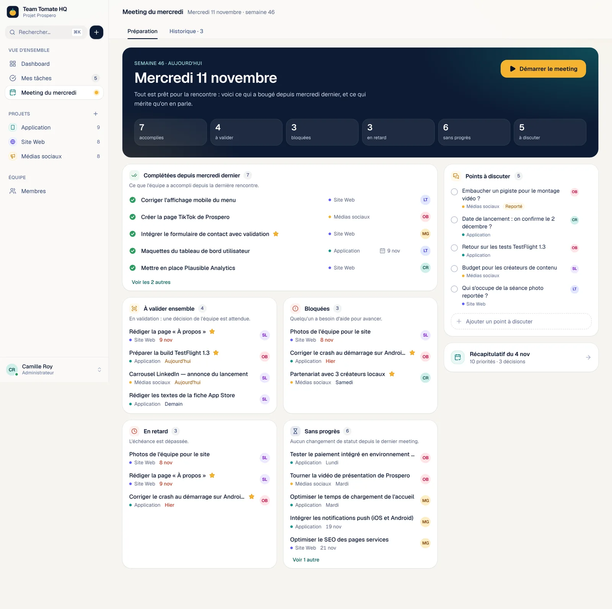

**Pendant.** « Démarrer le meeting » ouvre le mode réunion pour tout le monde, en temps réel. Une barre sombre porte le chronomètre et les étapes : tour d'horizon → un projet à la fois → priorités → clôture. Dans chaque projet, une ligne d'ajout permet de créer une tâche et de l'assigner d'un clic sur un avatar, sans quitter le meeting. L'étoile marque les priorités. À droite, toujours visibles : points à discuter et décisions prises.

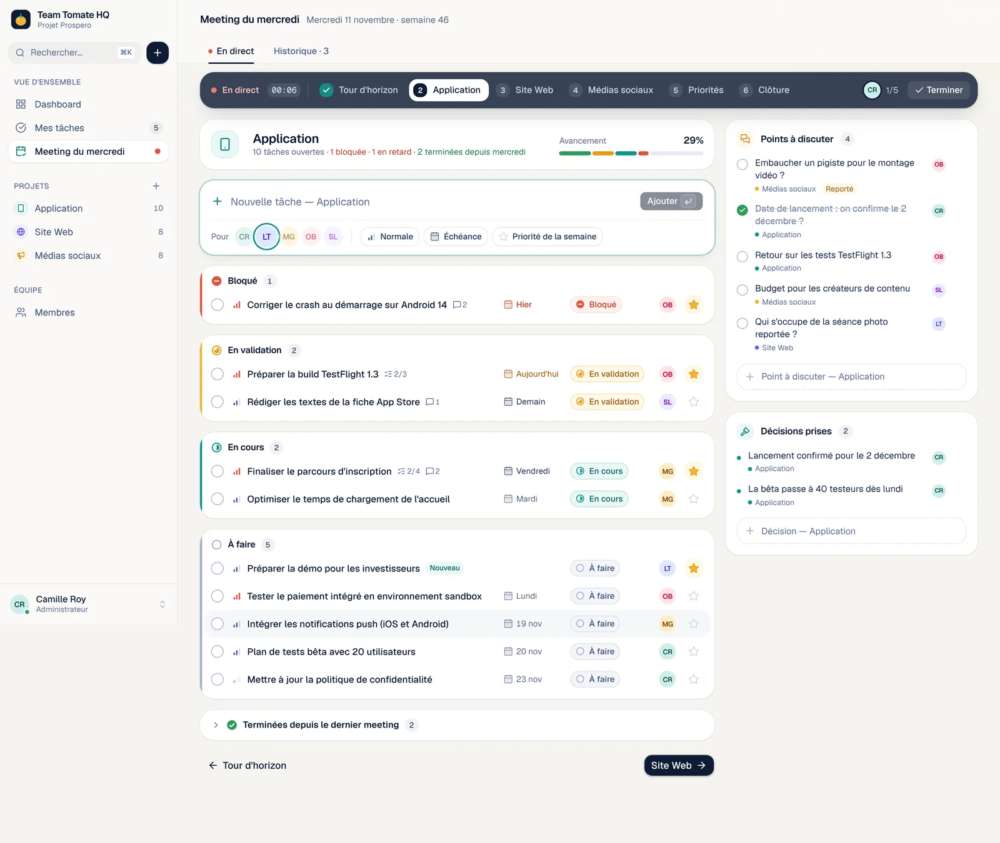

L'étape **Priorités** est une seule liste, groupée par personne. Elle rappelle les priorités de la semaine précédente restées ouvertes, à reconduire d'un clic.

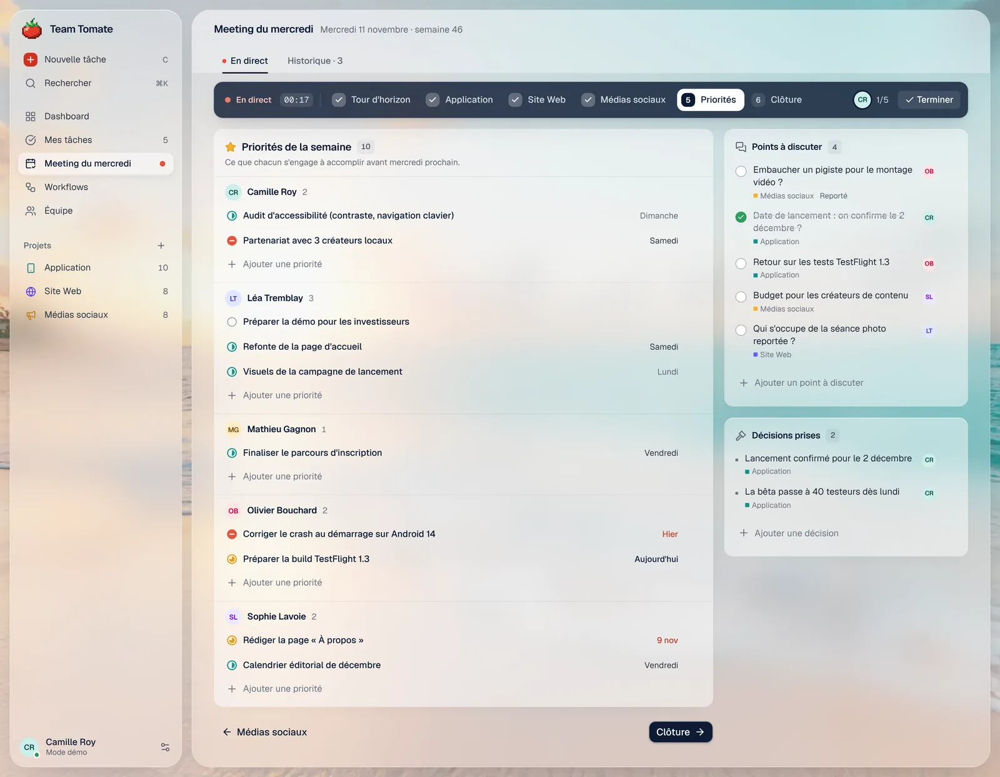

**Après.** La clôture enregistre un récapitulatif figé, présenté comme un compte rendu sur une seule feuille : priorités par responsable, nouvelles tâches, accompli, décisions, points reportés. Il rejoint l'historique et se copie en texte simple pour un courriel.

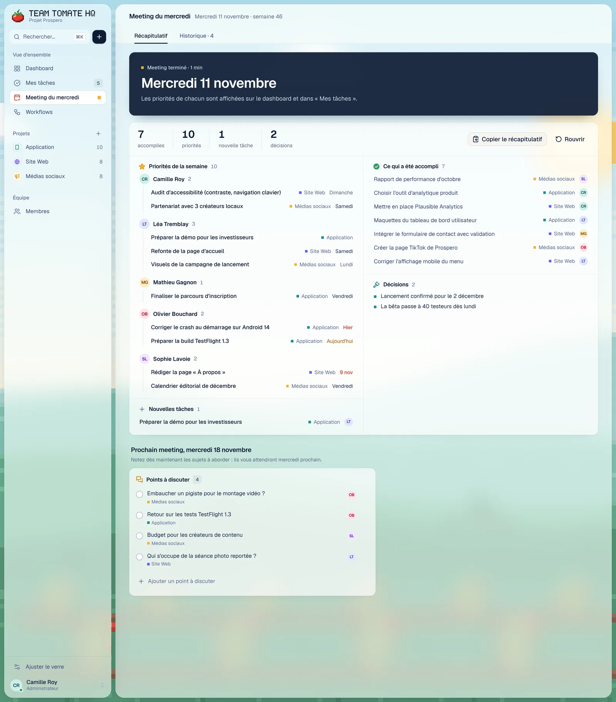

### Workflows — découper un livrable et donner chaque morceau

Un workflow, c'est un livrable découpé en étapes, chacune donnée à quelqu'un. Une automatisation courriel, par exemple : le design à Maya, le texte à Antoine, l'intégration à Jimmy, la validation au meeting. Une liste de canevas, chacun avec son aperçu miniature, puis un éditeur.

- **Étapes** de cinq natures : déclencheur, tâche, action, validation, livraison — chacune avec son nom, ce qu'elle fait, l'outil concerné, et surtout **son projet et son responsable**. Une étape est du travail pour quelqu'un : il n'y a pas d'« agent », rien ne tourne tout seul. Le canevas est en un seul ton : les natures se distinguent par leur glyphe.
- **Donner une étape, d'un clic** : au pied de chaque étape, deux pastilles, le projet à gauche et la personne à droite. Un clic ouvre le menu (les projets ouverts, les membres actifs, soi-même en premier) ; « Sans projet » et « À assigner », cerclées, disent ce qui reste à choisir. Chaque choix est une modification comme une autre : annoncée, enregistrée, reprise par « Annuler ». Le formulaire « Modifier l'étape » offre les mêmes choix, avec le nom et la description. Un nouveau workflow commence par une première étape à nommer et à donner, dans le projet du workflow s'il en a un.
- **Pile d'actions** à droite : des étapes toutes prêtes, rangées par genre de travail (design, courriel, site web…). Un clic ajoute l'étape après l'étape sélectionnée et la relie. Un genre n'est pas un projet : une étape de design ou un courriel va dans le projet qu'on lui choisit (Application, Site Web, Médias sociaux…), avec la personne qu'on lui choisit.
- **Créer les tâches** : le bouton principal du canevas. Il montre d'abord ce qui sera créé (une tâche par étape qui a un projet, dans l'ordre du dessin, chez la personne de l'étape ; un déclencheur n'est pas une tâche), avec un champ « Pour quoi ? » qui s'ajoute au nom des tâches quand le même workflow sert plusieurs fois. Ensuite chaque étape porte l'état de sa tâche et l'ouvre d'un clic ; la tâche, elle, affiche son workflow et son étape, et y ramène.
- **Liens** par glisser d'un port à l'autre ; les boucles et les doublons sont refusés. Un formulaire replié permet de tout faire au clavier.
- **Enregistrement automatique** une demi-seconde après chaque modification, et à la sortie de la page. Les modifications d'un coéquipier arrivent en direct. L'export JSON est dans le menu « … » de la page.

Un workflow distribue le travail quand on le lance, et rien d'autre : les tâches sont toutes créées d'un coup, et terminer une étape ne démarre pas la suivante.

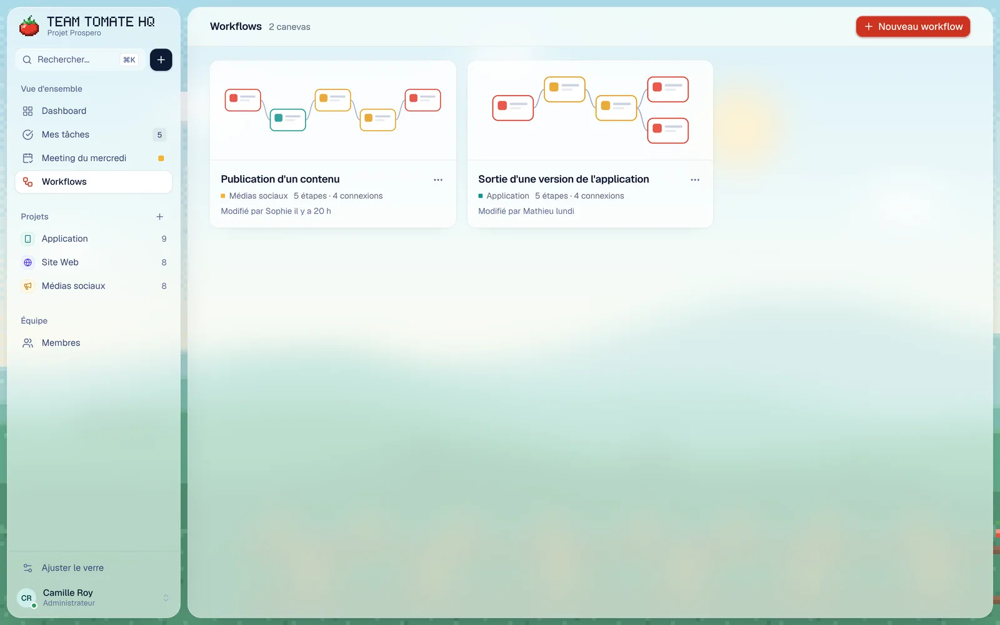
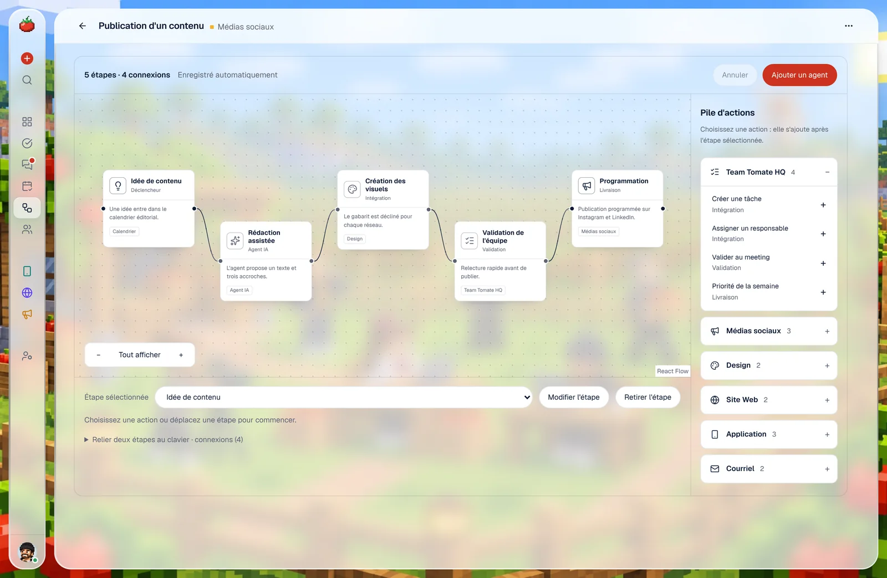

### Arcade — Tomato Tower

Le jeu de l'équipe, dans sa propre section de la navigation. Une seule scène en trois dimensions occupe toute la fenêtre : une petite ferme en blocs, et, au milieu, la palette où monte la tour. Par-dessus, un seul écran à la fois.

**Le jeu.** Une caisse de tomates se balance au-dessus de la tour, une fois dans un sens, une fois dans l'autre. Espace, un clic ou un toucher la lâche. Ce qui dépasse est coupé et tombe ; la caisse suivante a la taille de ce qui est resté. Pile dessus, rien n'est coupé : c'est un **parfait**. À côté, la partie est finie. La balance s'accélère avec la hauteur.

- **Points** : 100 pour une caisse posée, 200 pour un parfait. Deux parfaits de suite valent double, trois valent triple, jusqu'à **x5**. Tous les dix étages, 1 000 points de bonus. À partir de quatre parfaits de suite, la caisse regagne un peu de largeur.
- **Parfait** : à 6 % près de la caisse, et jamais moins que ce qu'elle parcourt en deux soixantièmes de seconde : aussi vite qu'elle aille, lâcher un rien trop tôt ou trop tard reste un parfait.
- **Le ciel** change avec la hauteur : matin à la ferme, plein midi (10 étages), coucher de soleil (20), nuit étoilée (30), au-dessus des nuages (40). La lumière de la scène suit, les lanternes s'allument, et l'île est assez petite pour que le ciel prenne l'image à mesure que la tour monte.
- **Mon personnage** : chaque partenaire a le sien, tiré de son portrait (cheveux, barbe, vêtements), tête à huit pixels de côté. Le mien monte avec la tour sur un monte-charge de planches, à côté du sommet : il sautille sur un parfait, lève les bras sur un record, s'effondre sur un raté. Les autres vaquent dans le champ.
- **La caméra** est isométrique, un peu plongeante ; elle suit le sommet et recule doucement. À la fin, elle recule jusqu'à montrer la tour entière.

**L'accueil du jeu** : le titre en lettrage pixel, « Stack it. Grow it. Own it. », PLAY NOW et TEAM TOWER, mon record, le temps qui reste avant la remise à zéro, et, à côté, le haut du classement de la semaine avec le champion en titre. Quelques caisses empilées sur la palette disent de quoi il s'agit avant qu'on lise.

**Pendant la partie**, l'interface se réduit à ce qui se lit d'un coup d'œil : le score en grands chiffres blancs cernés d'encre (lisibles sur une grange comme sur un nuage), l'étage, le combo en pastille jaune, le score à battre (« Plus que 700 points pour battre Jimmy ! », puis le suivant, puis « KING OF TOMATOES 👑 » quand il n'y a plus personne devant), la pause et le son. Ce que vaut chaque caisse surgit sous le score et s'en va. `P` ou `Échap` met en pause, `M` coupe le son ; changer d'onglet met la partie en pause.

**La fin** arrive en moins d'une seconde : une des phrases du jeu (« T'as échappé la sauce. », « La tour est morte. Vive la tour. »…), le score, les étages, le meilleur combo, la place dans la semaine, « NOUVEAU RECORD » s'il y a lieu, puis PLAY AGAIN et LEADERBOARD. La carte prend le focus, pas le bouton : la barre d'espace, qui lâchait des caisses une seconde plus tôt, ne relance rien ; `Entrée` rejoue.

**Les classements** : THIS WEEK, ALL TIME, MY STATS. Chaque ligne donne le rang, le visage, le nom, les étages, le meilleur combo, le nombre de parties et le score ; BEAT THIS SCORE lance une partie à la poursuite de ce score-là. Les trois premiers montent sur un podium de blocs, dans la scène. La semaine repart de zéro le **lundi à 0 h, heure de Montréal** ; les semaines passées restent sous le classement, et le gagnant de la dernière porte une **couronne dorée à trois tomates** sur son visage, partout dans l'application. Quand quelqu'un me prend la tête de la semaine, l'application me le dit où que je sois (« Maya vient de détruire ton record 🍅 »).

**Team Tower** : une seule tour pour toute l'équipe. Chacun pose **une caisse par jour**, à son visage. Une caisse de travers laisse moins de place à la suivante ; un parfait en rend un peu ; une caisse à côté, et la tour tombe pour la journée (« La tour est morte. Vive la tour. », avec le nom de qui l'a fait tomber). Une tour neuve commence le lendemain. Le panneau donne la hauteur, le record, qui a joué aujourd'hui, la meilleure journée, les caisses de chacun et la tour étage par étage. La caisse d'un coéquipier arrive en direct dans la scène. « Pas maintenant » remet sa caisse à plus tard sans la dépenser.

**La composition.** Les panneaux sont du papier opaque, jamais du verre : ils se lisent quoi qu'il y ait derrière, de jour comme le soir. La scène, elle, garde son sujet hors des panneaux : elle mesure la place qu'ils laissent et cadre la tour dans la plus grande bande libre (à gauche d'un classement sur un grand écran, au-dessus de lui sur un téléphone). Sur un téléphone, en portrait, tout tient sans défilement, et le doigt sur l'image lâche la caisse sans jamais faire défiler la page.

**Le son** est fabriqué sur place (quelques oscillateurs, un souffle) : une caisse posée, un parfait qui monte la gamme avec la série, le combo, le bonus, le record, la chute. Rien ne joue avant un premier geste, et le choix de couper le son est gardé.

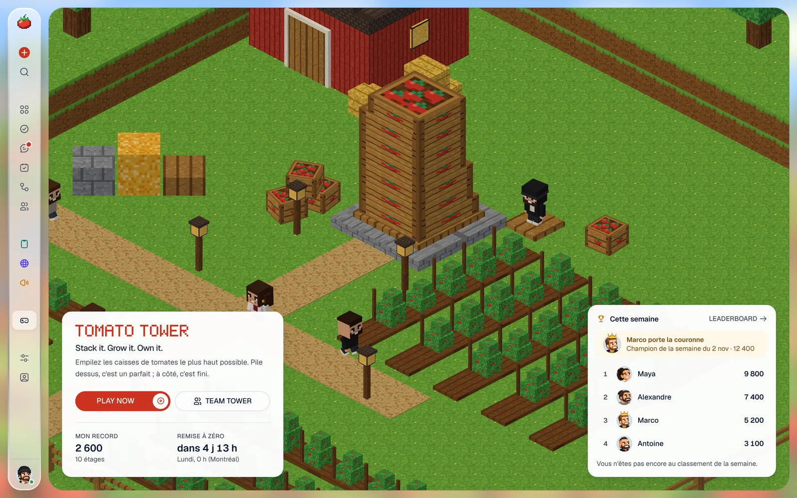
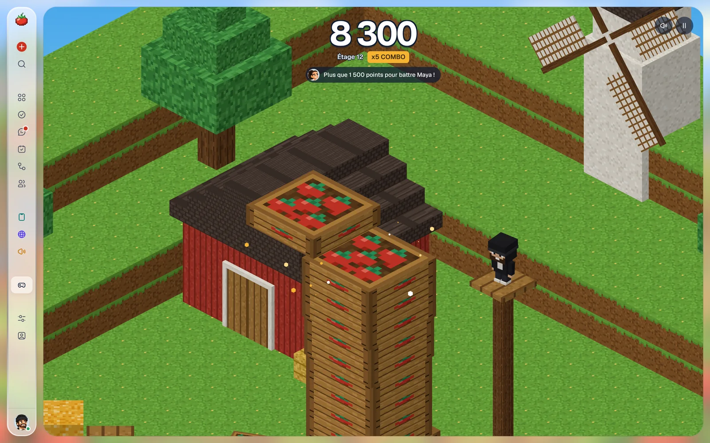
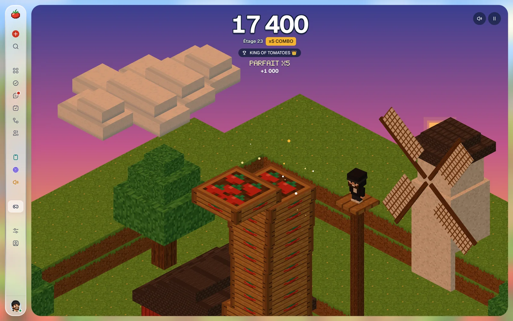
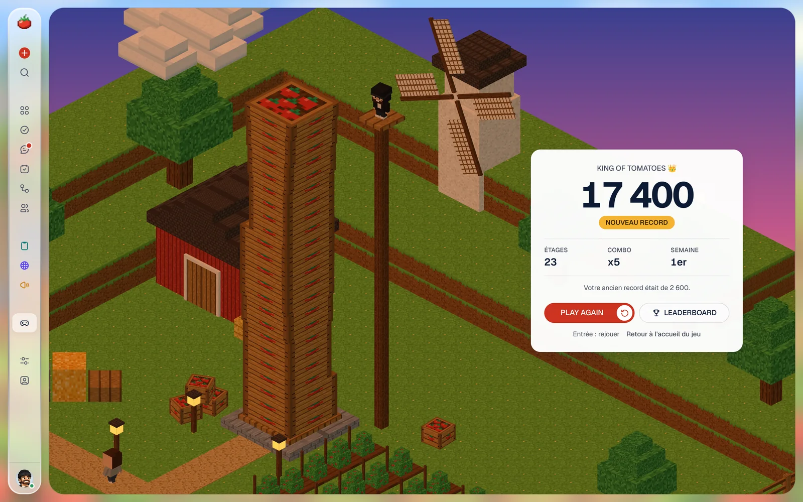
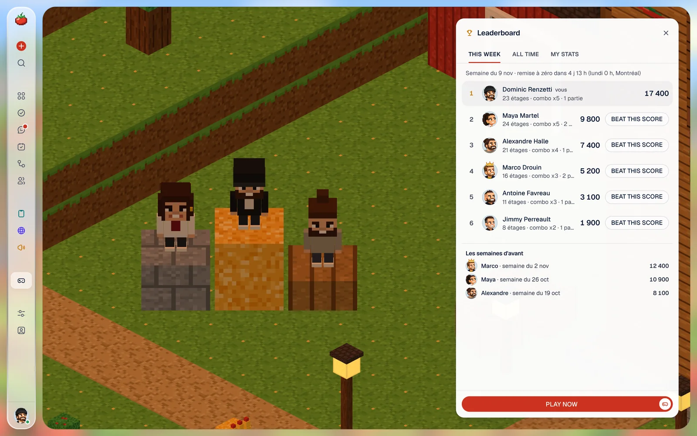
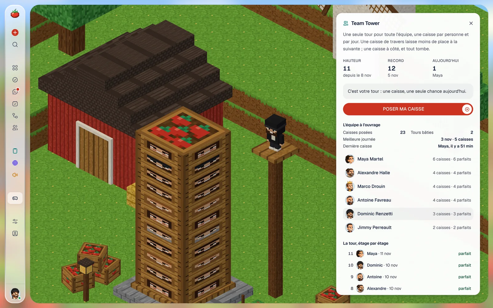

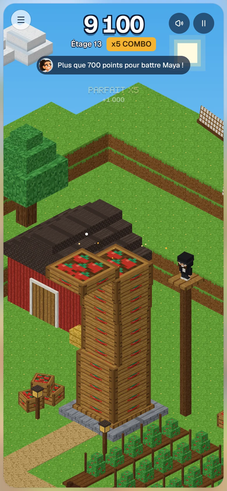 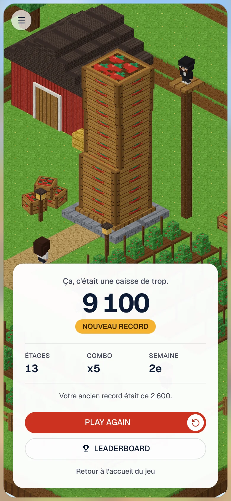

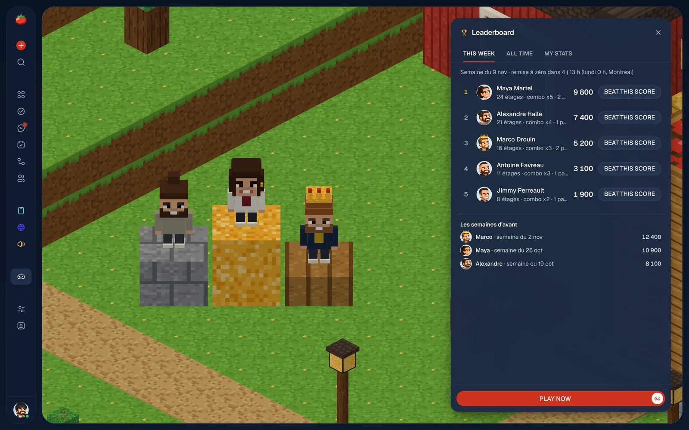

### Paramètres — l'apparence, le compte et les notifications pour tous, les membres pour les administrateurs

La navigation porte une section « Paramètres », dont les sections sont les onglets d'un même écran, `/parametres` : **Apparence** (la scène, le verre : un choix personnel, gardé dans le navigateur), **Compte** (changer son mot de passe, en donnant l'actuel) et **Notifications** pour tout le monde, le menu du compte y mène aussi ; **Membres** pour les administrateurs seulement.

**Notifications.** Un seul panneau, dans l'ordre où l'on en a besoin. *Cet appareil* d'abord : une cloche et une phrase (« Activées sur cet appareil. » ou « Désactivées… »), et le bouton qui va avec : « Activer sur cet appareil », puis « Envoyer un essai » et « Désactiver ». Les notifications s'activent appareil par appareil, parce que chaque navigateur demande sa propre permission ; l'écran ne laisse jamais personne devant un bouton qui ne ferait rien : sur un iPhone où l'application n'est pas installée, il donne les trois gestes pour l'installer ; si la permission a été refusée, il dit où la redonner ; si le navigateur ne sait pas, il le dit. *Me prévenir pour* ensuite : quatre interrupteurs (nouvelle tâche, tâche terminée, tâche bloquée, record à Tomato Tower) et un choix, « Toute l'équipe » ou « Seulement les miennes ». Ces choix valent pour tous les appareils de la personne. *Mes appareils* enfin : la liste de ceux qui reçoivent, chacun retirable.

Une notification tient en un titre et une ligne : qui, quoi, dans quel projet (« Dominic vous confie une tâche » · « Maquette de la page tarifs · Site Web »). Un clic ouvre l'application sur la tâche, dans son projet ; si elle était déjà ouverte, elle y va sans se recharger. Celles du jeu parlent comme le jeu (« Maya vient de détruire ton record 🍅 »).

Trois rôles, du plus courant au plus rare. Le **partenaire** voit et modifie les projets, les tâches et les meetings. L'**administrateur** gère en plus l'accès des partenaires (activer, désactiver) et les invite. Le **super administrateur**, le premier compte de l'équipe, décide en plus des rôles, des comptes et de leurs mots de passe ; il en reste toujours au moins un. L'écran ne montre à chacun que ce qu'il peut faire, et la base tient les mêmes règles.

L'écran des membres tient en une tuile d'en-tête (le nombre de membres, une recherche par nom ou courriel, puis « Ajouter un membre » et « Inviter » pour le super administrateur, « Inviter des membres » pour un administrateur) et un tableau : nom, courriel, rôle, date d'arrivée, et un menu d'actions par ligne. Un compte en attente d'approbation s'active d'un clic. On n'agit pas sur sa propre ligne, ni, pour un administrateur, sur celle d'un autre administrateur.

**Ajouter un membre** crée le compte sur-le-champ, sans courriel : nom, courriel, rôle, et un mot de passe temporaire que l'application propose en quatre groupes de quatre caractères sans lettres ambiguës, faciles à dicter (« Générer » en écrit un autre). La fenêtre montre ensuite, une seule fois, les deux lignes à transmettre, avec « Copier ». Dans le tableau, la personne porte la mention « mot de passe à changer » tant qu'elle n'a pas choisi le sien. **Définir un mot de passe…**, dans le menu d'une ligne, fait la même chose pour un compte qui existe : l'ancien mot de passe cesse de fonctionner, le nouveau est temporaire. **Modifier le courriel…** corrige l'adresse avec laquelle la personne se connecte (la sienne aussi, pour le super administrateur) : le mot de passe ne change pas, aucun message n'est envoyé, et dès l'enregistrement seule la nouvelle adresse ouvre le compte.

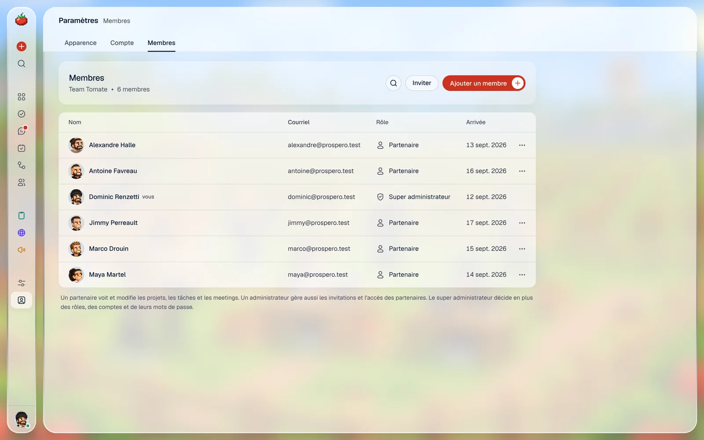
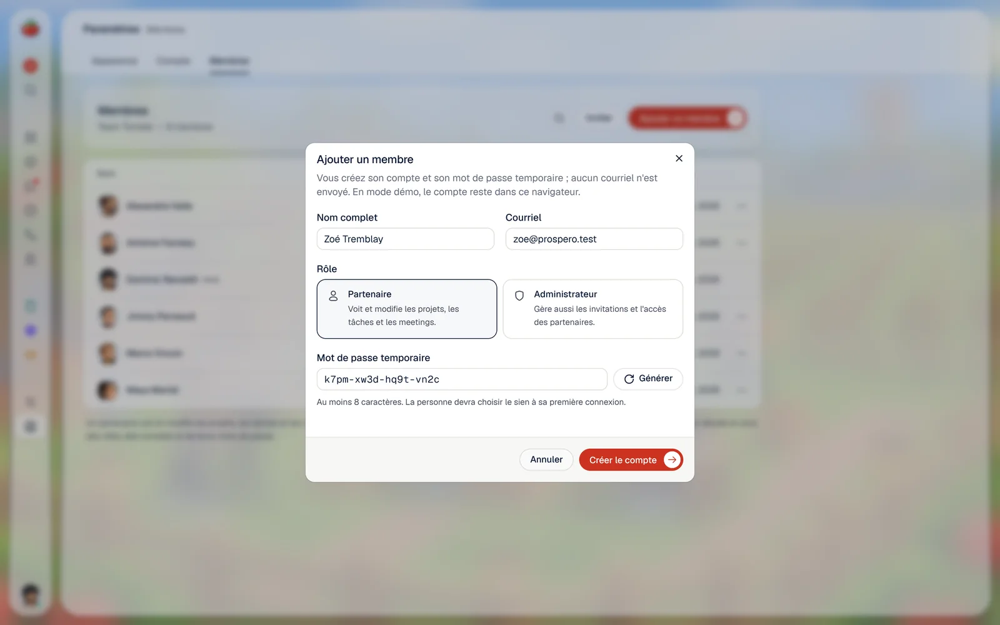

### Connexion

Hors de l'espace de travail, la scène est nette : la ferme en plein écran. Dessus, une carte de verre sombre, comme un menu de jeu posé sur son paysage : la tomate, le nom en lettrage pixel, puis le formulaire. La carte s'incline en 3D sous la souris et des lumières parcourent ses bords. Sans souris (téléphone) ou avec « moins de mouvement », la carte reste à plat.

Courriel et mot de passe par défaut ; « Recevoir un lien par courriel » reste l'autre façon d'entrer. « Mot de passe oublié ? » n'envoie rien : la carte répond que le super administrateur en définit un nouveau dans les paramètres. Tant que l'équipe est vide, la même carte propose « Premier compte » (nom, courriel, mot de passe) : c'est ainsi que naît le super administrateur.

Quand le mot de passe vient d'être défini par le super administrateur, la connexion ne mène pas à l'application mais à une page seule, « Choisissez votre mot de passe » : deux champs, pour attraper une faute de frappe, et le mot de passe temporaire lui-même est refusé. Tant que ce n'est pas fait, la base ne montre à cette personne que sa propre ligne.

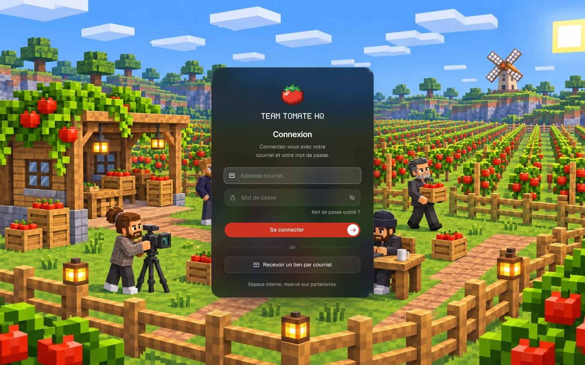

### Mobile

Un seul bouton de menu, en haut à gauche de chaque écran : trois traits qui se replient en croix. Il ouvre la navigation en plein écran, sur une feuille de verre givré, avec des lignes à la taille du doigt. Quand le libellé d'un bouton principal n'a pas sa place (« Nouveau message », « Envoyer », « Nouveau workflow »), il se réduit à un disque tomate. La fenêtre de verre garde une petite marge autour d'elle ; sur le dashboard la salutation rapetisse sans perdre son portrait, les cartes de l'équipe passent à deux de front sous celle du score, et le pied s'empile ; le tableau ne garde que le titre, le statut et le responsable, le kanban défile horizontalement. Les titres passent sur deux lignes plutôt que d'être tronqués. Les lignes de tâche s'adaptent à la largeur de leur conteneur (et non de l'écran).

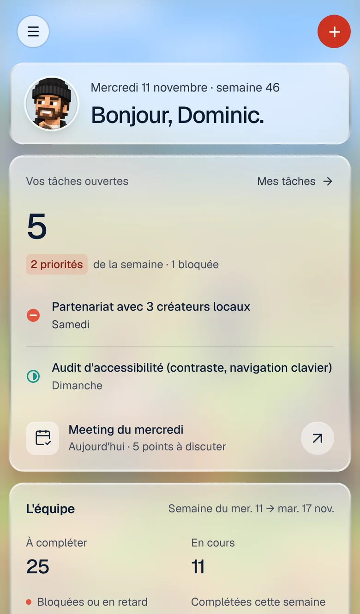 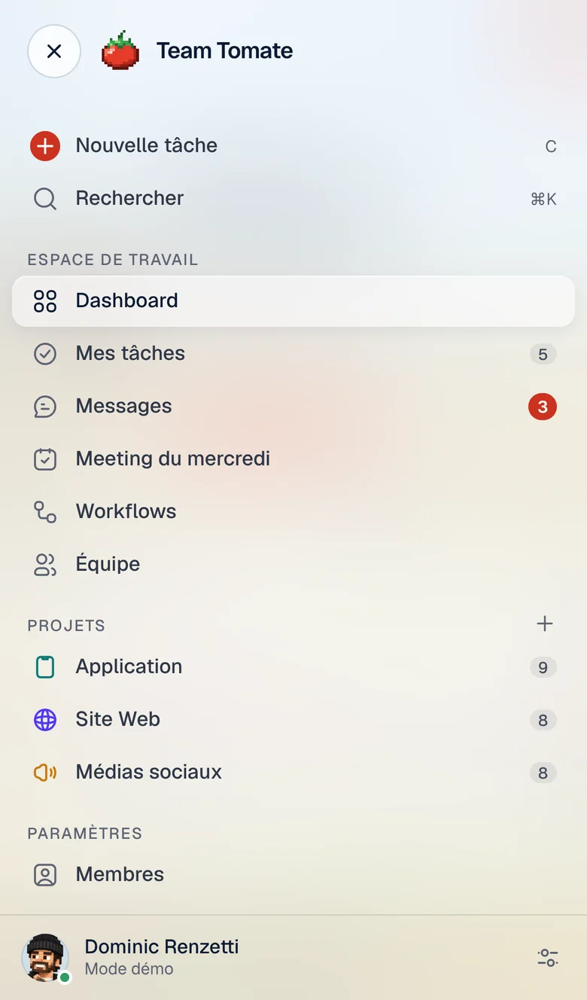 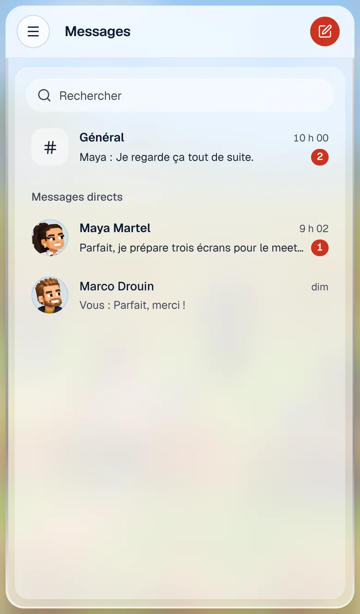 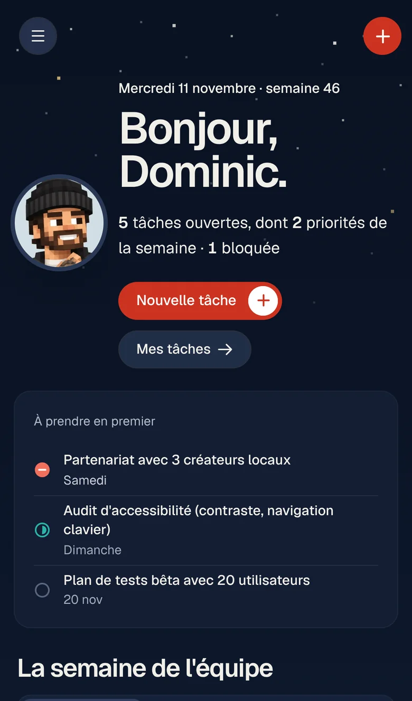

## 3. Règles métier visibles

- **Semaine** : du mercredi 00 h au mardi soir (`lib/dates.ts`).
- **Priorités de la semaine** : elles appartiennent à un meeting. L'étoile modifie celles du meeting en cours, sinon du dernier meeting tenu. Le dashboard affiche celles du dernier meeting tenu, puis celles du meeting en cours dès qu'il en définit.
- **Sans progrès** : tâche ouverte dont le statut n'a pas changé depuis le début du meeting précédent.
- **En retard** : échéance passée et tâche non terminée.
- **Progression d'un projet** : tâches terminées (archivées comprises) ÷ toutes les tâches.
- **Récapitulatif** : calculé en direct pendant le meeting, figé à la clôture. L'historique ne bouge plus, même si les tâches changent ensuite.
- **Points à discuter** non traités : ils réapparaissent au meeting suivant avec la mention « Reporté ».
- **Workflow** : enregistré d'un bloc ; en cas de modification simultanée, la dernière sauvegarde l'emporte. Le lancer crée une tâche par étape qui a un projet (jamais pour un déclencheur, ni dans un projet archivé ; une personne qui n'a plus accès ne reçoit rien, la tâche est créée sans responsable). Supprimer le workflow laisse ses tâches en place.
- **Messages** : le canal « Général » est lu par tous les membres actifs ; une conversation directe n'existe que pour ses deux membres (la base ne la livre à personne d'autre, y compris en temps réel). Un message ne se modifie pas ; son auteur peut le supprimer. L'auteur, l'heure d'envoi et « lu jusqu'ici » sont fixés par le serveur.
- **Notifications** : jamais pour ce que l'on fait soi-même. Une tâche créée, terminée ou bloquée par quelqu'un d'autre est annoncée à toute l'équipe, ou seulement à sa responsable et à son auteur pour qui a choisi « Seulement les miennes » ; une tâche qu'on me confie m'est toujours annoncée (sous l'interrupteur « Nouvelle tâche »). Plusieurs nouvelles du même genre arrivées ensemble font un seul message : un workflow qui crée quatre tâches ne fait pas sonner quatre fois. Démarrer une tâche, la renommer, la rouvrir ne s'annonce pas. À Tomato Tower : la première marque de la semaine, puis chaque fois que la tête de la semaine ou le record de tous les temps change de mains ; quelqu'un qui bat son propre score ne dérange personne. Rien n'est annoncé pour une tâche archivée, supprimée entre-temps, ou vieille de plus de quinze minutes (`lib/push.ts`).
- **Tomate qui mûrit** : seulement pour un statut que je change moi-même ; ce que changent les autres arrive sans bruit.
- **Averse de tomates** : seulement pour une tâche que je termine moi-même, à l'instant. Rien pour ce que terminent les autres, ni quand on rouvre une tâche.

- **Tomato Tower, le score** : compté par les règles (`lib/tower/engine.ts`), jamais déclaré. Le serveur rejoue la partie et inscrit ce qu'il a compté ; une partie sans aucune caisse posée n'est pas enregistrée. Une partie arrêtée (« Arrêter là », « Recommencer ») compte pour ce qui était bâti.
- **Tomato Tower, la semaine** : du lundi 0 h au dimanche soir, heure de Montréal, pour tout le monde. Le classement de la semaine est le meilleur score de chacun dans la semaine ; rien n'est effacé, la semaine est une date sur chaque partie.
- **Tomato Tower, la couronne** : au gagnant de la dernière semaine terminée, jusqu'au lundi suivant.
- **Team Tower** : une caisse par personne et par jour (le jour de Montréal). Si deux caisses sont lâchées au même instant, une seule prend l'étage ; l'autre personne est invitée à viser de nouveau, sa caisse n'est pas dépensée. Une tour tombée ne se relève pas le jour même.

Ces règles vivent dans `lib/selectors.ts` (fonctions pures), pour que chaque écran raconte la même histoire ; celles du jeu, dans `lib/tower/`.

## 4. Design system

Références : Linear pour la sobriété et les interactions, Things pour le calme, Monday pour la structure des tâches. Les jetons sont déclarés dans `src/app/globals.css`.

### Le parti pris

Du verre sur un paysage, et un contenu très sobre posé dessus. L'idée vient du tableau de bord « verre ajustable » qui a servi de référence (une image en fond, des feuilles et des tuiles translucides, des réglages) ; la matière, elle, est le **verre poli** de Koloc Cloud : un anneau métallique, une face translucide, une ombre en huit couches. Le verre est clair ; c'est la photo, derrière, qui est givrée. Les paysages sont à nous : **la ferme**, l'équipe au travail dans son champ de tomates, et **le yacht**, la même équipe au coucher du soleil, en blocs façon jeu de construction. Le contenu reste du texte, des filets et de l'espace. L'autre fantaisie est la tomate en pixel art : elle est le logo, elle fait un salto au chargement, elle mûrit à côté des priorités de la semaine, et il en pleut quelques-unes quand une tâche se termine.

| Élément de marque | Où | Règle |
|---|---|---|
| **Tomate** (`kit/pixel-tomato.tsx`) | Logo, préchargeur, connexion ; sur le dashboard, la tomate de la semaine et le potager des priorités | Grille 16 × 16, dessinée en code, tailles multiples de 16. Elle **mûrit** en quatre étapes (verte → tournante → orangée → rouge) : dans le potager il y en a une par priorité, mûre comme le statut de sa tâche ; la tomate de la semaine, en tête de l'alignement, est mûre comme la semaine est avancée. |
| **Lettrage pixel** (`kit/pixel-text.tsx`) | Le nom, sur l'écran de connexion ; dans le jeu, son titre, « Pause » et « Parfait » | Alphabet 5 × 7 dessiné pixel par pixel. Jamais dans les écrans de travail. |
| **Portraits** (`public/avatars`, `lib/avatars.ts`) | Partout où une personne apparaît : salutation, tâches, messages, équipe, navigation | Les portraits en pixel art des six partenaires, des carrés de 256 px. Un membre reçoit le sien par son nom (ou son prénom seul, quand le profil n'a que lui) ; sans portrait, l'avatar montre des initiales sur la couleur du membre. Six tailles, de 24 à 72 px : 28 px dans une ligne de tâche, 32 px dans un fil de messages. Le dashboard les montre en grand : 84 à 168 px à côté de la salutation, 80 à 112 px en tête des cartes de l'équipe. |

| **Les blocs du jeu** (`arcade/scene/`) | Tomato Tower | L'univers en blocs des deux paysages, cette fois en volume : tout est une boîte, les textures sont des grilles de 16 pixels dessinées par le code (herbe, planches, pierre, caisse de tomates), sans lissage. Les personnages sont ceux des portraits, en cubes. Le jeu a ses propres couleurs de ciel ; ses panneaux, eux, sont ceux de l'application. |
| **La couronne** (`kit/member-avatar.tsx`) | Sur le visage du champion de la semaine de Tomato Tower, partout | Onze pixels de large, dorée, trois tomates aux pointes. Posée sur les cheveux, pas au-dessus de la tête : elle ne touche jamais ce qui est écrit autour d'un visage. |

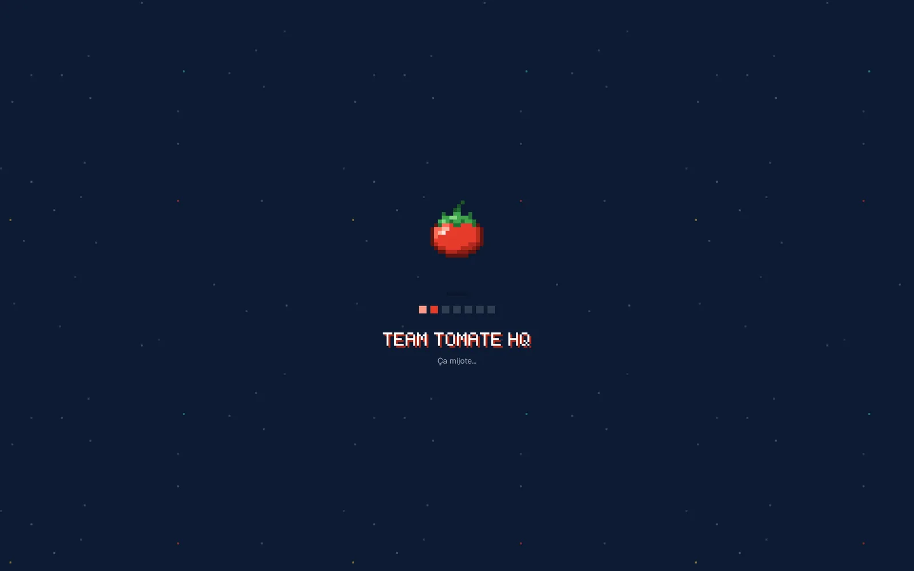

### Surfaces

| Couche | Classe | Rôle |
|---|---|---|
| **Scène** | `GlassBackdrop`, `.gw-scene` | La ferme (ou le yacht) en plein écran. Nette tant que le préchargeur est là, et sur l'écran de connexion. **Givrée** dès que l'application arrive : floutée (18 px), un peu plus saturée, sous un voile blanc de 40 %. C'est elle qui porte le givre, pas le verre. |
| **Feuilles** | `.gw-glass` | La navigation et, sur tous les écrans sauf le dashboard, la fenêtre principale, en verre poli : un **anneau** métallique de 2,5 px (un dégradé vertical, blanc en haut pour la lumière, foncé aux trois quarts pour l'épaisseur, blanc en bas pour le rebond, évidé en son centre par un masque), une **face** translucide à 58 % avec une très légère diagonale, sans flou propre (on voit à travers elle la même photo givrée qu'autour), et une **ombre** en huit couches dont le flou double presque à chaque cran. Coins de 24 et 27 px. |
| **Tuiles** | `.gw-panel` | Deux cas, pour ne jamais poser du verre sur du verre. **Sur le dashboard**, il n'y a pas de fenêtre : chaque carte est le verre, posée sur l'image, avec le même anneau (2 px), la même face que les feuilles (58 % par défaut) et l'ombre en huit couches ; la salutation, elle, n'est sur aucun verre : elle est écrite sur l'image, sur une brume blanche. **Dans une fenêtre** (messages, paramètres), une tuile n'est qu'une zone de la feuille : une face un peu plus pleine, une arête éclairée, une ombre à peine marquée, pas d'anneau. Coins de 17 px. |
| **Panneaux denses** | `.card-surface` | Tableaux, listes du meeting, colonnes du kanban : la même tuile, un peu plus remplie pour que le texte dense reste lisible. |
| **En-tête de page** | `.glass` | Colle en haut de la fenêtre et floute ce qui défile dessous. |
| **Sombre** | `.glass-dark`, `.gw-panel-live` | Réservé au meeting en direct : sa barre sur la page du meeting et son billet sur le dashboard. Le sombre veut dire « en direct ». |

Tout dérive de cinq variables (`--gw-blur`, `--gw-opacity`, `--gw-saturation`, `--gw-edge`, `--gw-tint`) et d'une sixième qui s'en déduit, `--gw-scene-veil`, le voile de la photo. **Paramètres → Apparence**, ouvert à tous les membres, les règle : la scène (la ferme ou le yacht, les deux images de l'équipe), quatre préréglages (**Clair** : givre 25 %, verre 34 % ; **Poli** : 45 % et 50 %, l'aspect par défaut ; **Givré** : 70 % et 64 % ; **Opaque** : 80 % et 86 %) et des réglages fins repliés : givre de la photo, opacité du verre, saturation, reflet des bords (il dose l'anneau), teinte. Choisir une scène lui donne le givre qui lui convient (le yacht, plus sombre que les champs, vient avec un verre à 56 %) ; les préréglages et les curseurs ajustent à partir de là. Le choix est propre à chaque navigateur.

**Givrer la photo est un seul geste** : le flou (jusqu'à 40 px) et le voile blanc montent ensemble (`sceneVeil`, dans `lib/glass.ts` : rien quand la photo est nette, 40 % au réglage par défaut, 50 % au plus). Le voile fait le travail que faisait un verre laiteux : il relève les parties sombres de la photo, et le verre posé dessus peut rester clair.

La recette vient de `ui/verre.css` de Koloc Cloud, portée sur ces variables. Là-bas le verre est posé sur une page grise et unie ; ici il est posé sur une photo chargée. Plutôt que d'épaissir le verre jusqu'à le rendre laiteux, c'est la photo qu'on givre. Quand la navigation s'ouvre par-dessus la page, elle prend la variante dense de la même matière (90 %, flou de 22 px) : c'est, avec l'en-tête de page, la seule surface qui floute ce qui est derrière elle.

**Encre sur verre.** Les gris ont été dessinés pour du papier. Sur un verre clair posé sur une photo, ils sont ramenés à un ton plus profond à l'intérieur de `.gw-scope` : `navy-500` et le texte atténué deviennent `navy-600`, `navy-400` s'en approche, et le rouge des retards comme le vert de « En ligne » passent à leur cran foncé. Les menus et les dialogues sont en papier, hors de cette portée : ils gardent les gris d'origine.

L'en-tête de page garde toujours au moins 18 px de flou, même quand le reste du verre est clair : du texte défile dessous.

Règle technique : deux surfaces qui floutent ce qui est derrière elles ne s'emboîtent jamais — un flou imbriqué est ignoré par Chrome, et un flou ne survit pas non plus à un parent en fondu. La feuille de la fenêtre est donc un calque à part, placé derrière la zone de défilement, pour que l'en-tête de page puisse flouter ce qui défile sous lui ; un écran demande à la coquille une fenêtre nue (`ui.setBareWindow`, ce que fait le dashboard) quand ses tuiles portent elles-mêmes le verre, et la zone de défilement va alors jusqu'aux bords de l'écran pour que les tuiles en sortent au lieu d'être coupées en plein vol. Autre règle : la face d'une surface est calculée sur la surface elle-même (une variable CSS est résolue là où elle est déclarée), et son opacité est une propriété enregistrée (`@property --verre-alpha`), ce qui lui permet de fondre d'une valeur à l'autre.

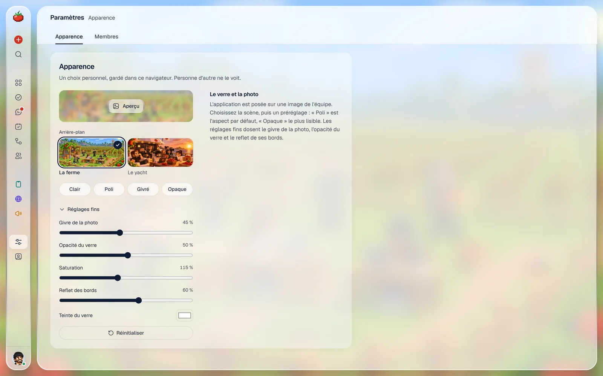

### Le soir — de l'encre mate, sans verre

Le verre a besoin de sa photo, et la photo est une image de plein jour. Le soir, le thème ne l'assombrit pas : il la range, et le verre avec elle. Plus rien n'est translucide ni flouté, ni la fenêtre, ni l'en-tête de page, ni le menu qui passe au-dessus, ni le fond d'un dialogue.

À la place, **de l'encre mate**. La page prend le navy de la marque, descendu jusqu'à la nuit ; une tuile est une dalle un cran plus claire, dessinée par un filet et sans ombre ; le texte est le blanc cassé de la marque, pas un blanc pur. Là où était la photo, **un ciel de quelques étoiles carrées**, de deux ou trois pixels, dont cinq tirent sur le jaune d'une lanterne vue de loin : la ferme, la nuit, dessinée dans le même pixel art que la tomate et les portraits. Rien n'y bouge. On le voit surtout sur le dashboard, dont les tuiles sont posées directement dessus.

| Surface | Valeur | |
|---|---|---|
| Le ciel (fond) | `#0a1222` → `#0d182c` | la couleur de la page et de la barre du navigateur |
| La fenêtre, la navigation | `#101a2f` | une feuille opaque |
| Une tuile, une carte | `#16223a` | la dalle ; `#131d33` posée sur le ciel |
| Un menu, un dialogue | `#1c2841` | le « papier » du soir |
| Un pan plus clair (survol, sélection) | `#2f3e5e` | ce que le blanc translucide fait le jour |
| Le meeting en direct | `#26375a` | la seule surface qui se détache, comme le jour |

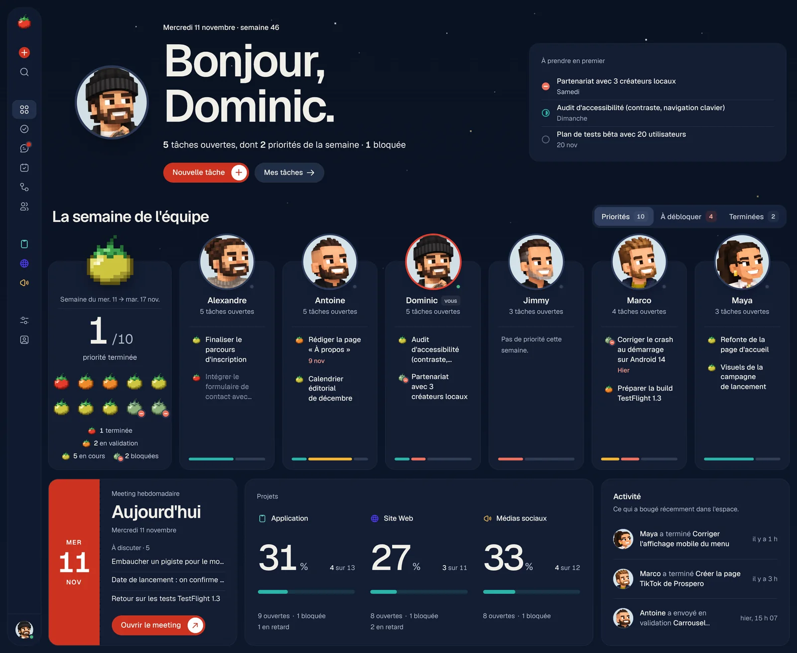
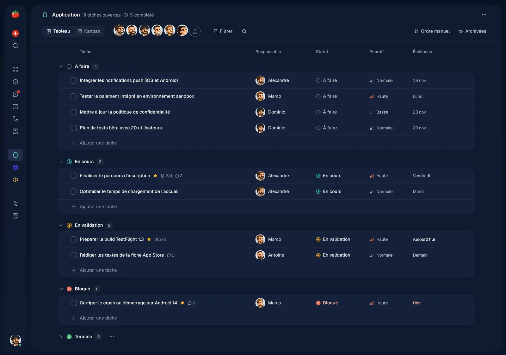
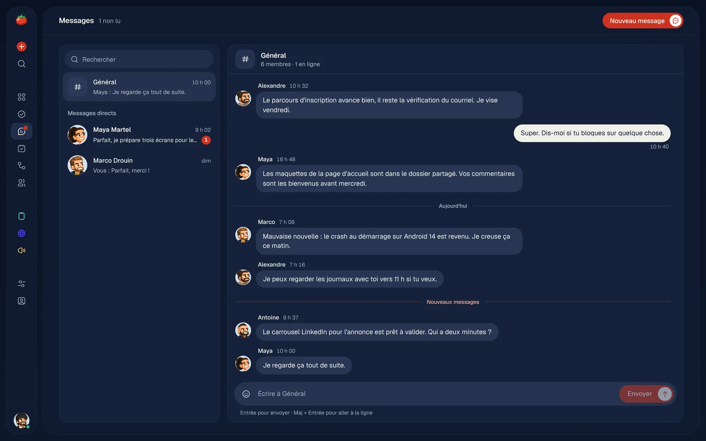

**Le choix.** Dans Paramètres → Apparence, trois cartes : « Clair », « Soir » et « Automatique » (clair le jour, soir de 19 h à 6 h, à l'heure de l'appareil). Comme le verre, c'est un choix personnel gardé dans le navigateur ; le défaut reste « Clair ». Le soir, les réglages du verre sont estompés et hors d'atteinte : ils sont ceux du thème clair et l'attendent.

**Comment c'est fait.** Un seul attribut, `data-theme="night"` sur `<html>` (`lib/theme.ts`), posé avant la première image par un court script dans `<head>` : une visite du soir n'affiche jamais le thème clair, même un instant. Le reste est un bloc de `globals.css`, « Le soir » : les mêmes noms de jetons avec leurs valeurs du soir (les gris `navy` s'inversent, les teintes pâles deviennent des teintes sombres, les crans de texte s'éclaircissent), puis les matières. Quatre jetons portent ce qui change de sens d'un thème à l'autre, et remplacent les blancs écrits en dur : `glaze` (un pan plus clair de la surface), `on-ink` (le texte posé sur une pastille d'encre), `spot` (la grande surface sombre à texte blanc) et `scrim` (ce qui assombrit la page derrière une fenêtre).

Deux endroits gardent les couleurs du jour, parce qu'ils sont sombres à texte clair dans les deux thèmes : l'écran de connexion (la scène nette, sa carte de verre sombre) et la barre du meeting en direct. Ils portent `.theme-day`, qui redonne à tout ce qu'ils contiennent les valeurs du jour ; un test vérifie que chaque jeton redéfini le soir y retrouve bien sa valeur d'origine.

**Lisibilité.** La mesure est la même que sur le verre (voir Accessibilité) : chaque morceau de texte comparé aux pixels réellement derrière lui. Le soir, elle passe sur huit écrans (dashboard, projet, messages, équipe, paramètres, mes tâches, meeting, workflows) à 4,5:1 au moins.

### Couleurs

| Rôle | Jeton | Valeur | Usage |
|---|---|---|---|
| Encre | `navy-900` | `#0D1B33` | Texte |
| Gris | `navy-300` à `navy-600` | — | Texte secondaire, icônes, bordures. Peu saturés : le texte secondaire est gris, pas bleu. Sur le verre, le texte secondaire est en `navy-600` (voir « Encre sur verre »). |
| Papier | `--background` | `#F2F0EB` | Sous les écrans d'erreur, et là où le flou n'est pas pris en charge |
| Teal | `teal-500` | `#12948C` | L'avancement : sur le dashboard, la barre de la semaine en cours, celles des projets, et la part « en cours » des barres de charge |
| Tomate | `tomato-600` | `#CC3320` | Le **bouton principal**, partout ; le repère « Nouvelle tâche » de la navigation ; la pastille des priorités de la semaine ; sur le dashboard, la souche du billet du meeting et celle du premier billet « À prendre en premier » (les deux seuls aplats de couleur de la page), le cercle autour de mon visage. Le chiffre des tâches à débloquer est du rouge des alertes (`coral-700`), qui s'éclaircit le soir |
| Statuts | teal, jaune, corail, vert | — | Uniquement dans les glyphes de statut, l'étoile des priorités et les alertes (retard, blocage) |

Les couleurs d'identification restent discrètes : une petite icône au trait pour un projet ; pour un membre, son portrait, ou à défaut une pastille pâle avec ses initiales.

**Statuts** — un glyphe par statut (`kit/status-icon.tsx`), un anneau qui se remplit à mesure que le travail avance. Le glyphe porte la couleur, le libellé reste en encre.

| À faire | En cours | En validation | Bloqué | Terminé |
|---|---|---|---|---|
| anneau gris | demi-anneau teal | trois quarts jaune | disque corail barré | disque vert coché |

**Priorités** — barres de signal : trois (Haute, corail), deux (Normale), une (Basse).

### Typographie

Geist Sans. Chiffres tabulaires pour les compteurs et les dates. Une échelle courte, sans demi-tailles, en casse normale :

| Usage | Taille |
|---|---|
| Salutation du dashboard | 42 – 112 px, 600, interlettrage −0,045 em, interligne 0,94 : ce qu'il y a de plus gros dans l'application |
| Le score de la semaine (dashboard) | 68 – 108 px, 500 |
| Pourcentage d'un projet, jour du billet, horloge du meeting | 40 – 68 px, selon la largeur de leur carte |
| « Dans 6 jours », sur le billet du meeting | 26 – 36 px, 600 |
| Titre d'une bande du dashboard (« La semaine de l'équipe ») | 24 – 34 px, 600 |
| Titre du meeting | 22 – 26 px, 600 |
| Titre de page, de groupe | 15 px, 600 |
| Corps, lignes de tâche, contrôles, titres de section | 13 px (14 px dans les formulaires) |
| Métadonnées | 12 px |
| Compteurs, raccourcis | 11 px |

### Icônes

Un seul jeu pour toute l'application : **Nova** (un jeu de la communauté Figma, 188 icônes au trait). Grille de 24 px, trait de 2 px à bouts ronds, formes tenues entre 3 et 21, conteneurs ronds (rayon 9) ou carrés aux coins arrondis (rayon 4). Une icône prend la couleur du texte qui l'entoure et se dimensionne comme lui (`size-4`, `size-[18px]`) ; l'épaisseur du trait se règle par `strokeWidth` (1,75 dans la navigation, 2,5 pour le « + » de « Nouvelle tâche »).

Le jeu ne se recopie pas à la main. `design/nova-icons.svg` est l'export de Figma, tel quel ; `design/icons.json` dit quel glyphe chaque icône de l'application utilise ; `npm run icons` en tire `src/components/kit/icons.tsx`. Les tracés sont repris à l'identique, seulement ramenés dans leur case de 24 px, et le noir devient la couleur du texte. Aucune icône ne vient d'ailleurs : la règle de lint `no-restricted-imports` refuse l'ancienne bibliothèque.

| D'où vient le dessin | Icônes | Exemples |
|---|---|---|
| Un glyphe Nova, tel quel (67 glyphes) | 74 | `Plus`, `Search`, `Calendar_check` (meeting), `Category` (dashboard), `Filter`, `Trash_2`, `Shield_done` (administrateur) |
| Un glyphe Nova tourné ou retourné | 6 | le chevron vers le bas, les flèches vers le haut, le bas et en diagonale ; `Bar-chart` couché pour la vue Tableau, renversé pour la vue Kanban |
| Un complément dessiné dans la grammaire de Nova (`design/icons-complements.svg`, 9 glyphes) | 11 | équipe (deux personnes), workflow, rafraîchir (et son miroir), #, sourire, touche Entrée, tri, poignée de glissement, point |

Quand Nova n'a pas l'icône exacte, on prend d'abord son glyphe le plus proche par le sens : archiver est un dossier avec une flèche vers le bas, une décision est une case cochée, le mégaphone des médias sociaux est un haut-parleur, donner ou retirer un accès est un cadenas ouvert ou fermé. On ne dessine un complément que lorsqu'aucun glyphe ne dit la chose.

Ne font pas partie du jeu, et restent dessinés par l'application : les glyphes de statut (un anneau qui se remplit), les barres de priorité, la tomate et le lettrage en pixel art.

### Forme et mouvement

- **Rayons** : 7 px (petits contrôles), 10 px (lignes de liste et de navigation), 13 px (panneaux denses), 17 px (tuiles), 24 et 27 px (feuilles). Les boutons sont des pastilles.
- **Boutons** (`ui/button.tsx`) : un seul bouton principal dans toute l'application, une pastille tomate avec un disque blanc à droite. Au survol (ou sous le doigt), le disque inonde le bouton, les couleurs s'inversent et une icône neuve glisse dans le disque. Le disque porte une flèche par défaut ; une icône écrite dans le bouton (`<Plus /> Nouveau workflow`) y prend place. Les variantes discrètes (contour, secondaire, fantôme) sont de simples pastilles. Les très petites tailles et les boutons-icônes sont des pastilles tomate pleines, sans disque. Quand le libellé n'a pas sa place sur un téléphone, `max-sm:af-compact` réduit le bouton à ce même disque tomate (le libellé quitte la page : le bouton porte alors un `aria-label`).
- **Navigation** (`ui/sidebar.tsx`, `app/sidebar.tsx`) : au repos, un rail d'icônes à côté de la fenêtre. Elle **s'ouvre sous la souris**, par-dessus la fenêtre (qui ne bouge pas), sur un verre plus dense et une ombre plus profonde, et se replie quand la souris repart (240 ms). Quelques règles la rendent prévisible : il faut un pointeur qui bouge et qui s'attarde 90 ms (la traverser n'ouvre rien) ; elle attend 260 ms avant de se replier ; elle se replie aussitôt qu'on a choisi une destination, pour ne pas couvrir l'écran demandé ; elle ne se replie pas tant qu'un de ses menus est ouvert. Rien ne saute à l'ouverture : la tomate, les icônes et l'avatar gardent leur place. L'**épingle** en haut (ou `⌘B`) la garde ouverte, et la fenêtre lui fait alors place ; le choix est gardé dans le navigateur. Une pastille claire glisse d'une entrée à l'autre pour marquer l'écran courant.
- **Infobulle des avatars** (`ui/animated-tooltip.tsx`) : sur les groupes d'avatars et les filtres par membre, le nom et le rôle surgissent avec un ressort et penchent avec le pointeur. Elle est rendue dans un portail : un tableau ou un panneau défilant ne la coupe jamais.
- **Séparations** : des filets à 10 % d'encre entre les lignes d'une tuile. Les tuiles se détachent par leur arête éclairée et une ombre très courte, jamais par un contour.
- **Avancement** : un filet de 3 px, encre sur gris, dans les listes ; une barre de 5 px, teal sur teal pâle, sur le dashboard (`kit/progress.tsx`).
- **Salutation** (`dashboard/hero.tsx`) : du texte posé sur l'image, sans carte. Sa taille suit la largeur de la page (unités de conteneur), ses deux lignes sont presque collées, et une brume blanche derrière elle remplace le verre.
- **Alignement de l'équipe** (`dashboard/week-lineup.tsx`) : une rangée de cartes dont la tête (la tomate de la semaine, un visage) est à cheval sur le bord du haut, moitié dehors, moitié dedans ; la rangée garde la place qu'il faut au-dessus d'elle. La carte du score est un peu plus large que celles des partenaires.
- **Barre de charge** : au pied d'une carte de partenaire, 5 px de haut, un segment par statut de ses tâches ouvertes, large comme leur nombre : teal en cours, jaune en validation, corail bloquée, gris à faire. Le survol en donne la légende.
- **Billet** (`dashboard/meeting-ticket.tsx`) : une souche tomate avec le jour en grand, une perforation en pointillé, puis le corps du billet. C'est une carte de verre comme les autres ; seule sa souche est un aplat.
- **Grand chiffre** (`dashboard/figure.tsx`) : un par carte, ce sur quoi l'œil se pose ; sa taille suit la largeur de la carte (unités de conteneur), et il compte jusqu'à sa valeur.
- **Potager** (`dashboard/potager.tsx`) : une tomate de 32 px par priorité, cinq par rangée ; au survol elle se soulève et dit son titre.
- **Onglets de la semaine** (`dashboard/week-lineup.tsx`) : un groupe de pastilles sur son propre bout de verre, l'onglet choisi en blanc ; chacun porte son compte, teinté de tomate quand quelque chose attend derrière.
- **Barres de la semaine** (`dashboard/week-bars.tsx`) : six barres, la semaine en cours en teal, les autres en gris ; le compte posé sur chaque barre, la date dessous.
- **Défilement** : seule la fenêtre principale défile.
- **Mouvement** : les tuiles se posent l'une après l'autre (elles montent de 12 px et deviennent nettes, 480 ms, 45 ms d'écart) ; la coche et l'étoile « rebondissent » une fois ; la carte glissée se soulève ; un message se pose dans le fil. Sur le dashboard, les deux lignes de la salutation montent de sous un cache (620 ms, 70 ms d'écart), les chiffres comptent depuis zéro (900 ms) quand leur carte arrive ou quand on change d'onglet, les tomates et les barres se posent l'une après l'autre, les barres des projets s'allongent. Tout est neutralisé avec `prefers-reduced-motion`.
- **Tomate qui mûrit** (`app/tomato-ripen.tsx`) : quand je change le statut d'une tâche (par le menu, la coche ou une carte glissée), une tomate de 48 px surgit là où je l'ai fait, dans la couleur du statut que la tâche quitte ; elle se ramasse, saute, change de couleur en l'air et retombe dans celle du nouveau statut (verte à faire, tournante en cours, orangée en validation, rouge terminée). Quand le travail avance, quelques étincelles partent à l'atterrissage ; quand la tâche se bloque, la tomate pâlit, prend son drapeau et frissonne. Un peu plus d'une seconde, sans prendre aucun clic.
- **Averse de tomates** (`app/tomato-rain.tsx`) : une tâche terminée fait tomber de huit à dix-huit tomates du logo, selon la largeur de l'écran. La largeur est découpée en tranches et chaque tomate tombe dans la sienne : jamais d'amas. Trois tailles (20, 28, 36 px), les petites plus lentes, une légère dérive et une rotation. Elles ne prennent aucun clic, et jusqu'à trois averses se superposent quand on enchaîne.
- **Arrivée et préchargeur** : à l'ouverture, la scène est seule à l'écran, nette ; ni navigation ni fenêtre. Par-dessus, une petite plaque de verre givré, haut dans le ciel pour ne cacher personne : la tomate y tombe, s'écrase, fait un salto (elle tourne autour d'elle-même, pas autour de sa base), puis alterne petit saut et salto tant que ça charge ; les sauts sont rythmés comme un vrai lancer (vite au départ, lent en haut). Elle reste au moins 3,25 s — la chute et deux tours de saut et de salto : le temps de regarder l'image. Puis la plaque s'en va, l'image reste et se givre (le flou et le voile arrivent en 900 ms), la navigation apparaît en fondu (500 ms) et les tuiles se posent l'une après l'autre. Tout est mesuré en « pixels de tomate » (7 px, 6 px sur téléphone), en CSS pur.

### Composants

| Dossier | Contenu |
|---|---|
| `components/ui` | Primitives shadcn/Radix restylées avec les jetons, et les composants repris des références (voir plus bas) |
| `components/kit` | Briques de l'application : `icons` (les icônes, générées depuis le jeu Nova), `PixelTomato`, `PixelText`, `ProgressLine`, `StatusIcon`, `StatusLabel`, `PriorityIcon`, `MemberAvatar`, `DueLabel`, `PriorityStar`, `TaskCheck`, sélecteurs, `EmptyState` |
| `components/app` | Coquille : `GlassBackdrop`, `GlassScene`, `GlassSettingsPanel`, `ThemeSync` (le thème du soir), `Preloader`, `TomatoRain`, `TomatoRipen`, navigation (bureau et téléphone), recherche |
| `components/chat` | Messages : `ChatPage` (les deux volets), `ConversationList`, `Thread`, `Composer`, `NewMessage`, `EmojiPicker` ; les règles pures sont dans `lib/chat.ts` |
| `components/auth` | `LoginScreen` (la scène et la carte), `LoginForm` (mot de passe, lien par courriel, premier compte), `OwnPasswordForm` (choisir son mot de passe : première connexion et Paramètres → Compte) |
| `components/settings` | Paramètres : `AppearanceSection`, `AccountSection`, et pour les administrateurs `MembersSection` (tableau, invitation, rôles) avec `NewAccountDialog` et `PasswordDialog` (comptes et mots de passe, super administrateur) |
| `components/tasks` | `TaskLine` (ligne compacte réutilisée partout), `TaskSheet`, `Attachments` (les fichiers d'une tâche : tuiles, envoi, visionneuse), menus contextuels, `QuickAdd` |
| `components/dashboard` | Les trois bandes de la page : `Hero` (la salutation), `WeekLineup` (la semaine de l'équipe en cartes et en trois onglets, avec son `Potager` et ses `WeekBars`), puis le pied : `MeetingTicket`, `ProjectCards`, `ActivityFeed`. Et leurs briques : `Panel` (une carte de verre), `Figure` (le grand chiffre qui compte) |

Règle de composition : une information = un composant, réutilisé partout. Le statut d'une tâche a la même apparence dans le tableau, le kanban, le dashboard et le meeting.

### Références reprises

Plusieurs briques viennent de composants que l'équipe a choisis comme références. Chacun a été adapté à nos jetons, à nos icônes (le jeu Nova) et à nos données, plutôt que copié tel quel ; l'en-tête du fichier dit ce qui a changé.

| Référence | Ce que c'est devenu | Où |
|---|---|---|
| Adjustable glass dashboard | Le principe : une image, des feuilles et des tuiles de verre, des réglages | `globals.css`, `lib/glass.ts`, `components/app/glass.tsx` |
| Verre poli (Koloc Cloud, `ui/verre.css`) | La matière : anneau métallique évidé, face translucide, ombre en huit couches | `globals.css` (`.gw-glass`, `.gw-panel`) |
| Tableau de bord de Koloc Cloud | L'ouverture du dashboard : une salutation typographique en très grand à côté d'un portrait, dont les lignes montent de sous un cache | `dashboard/hero.tsx`, `globals.css` (`.dash-hero`, `.dash-hello`) |
| Nova Icon (jeu d'icônes de la communauté Figma, version 1.1) | Toutes les icônes de l'application | `design/`, `scripts/build-icons.mjs`, `kit/icons.tsx` |
| Interactive workflow blueprint | Le canevas des workflows | `ui/interactive-workflow-blueprint.tsx` |
| Sidebar (Wensity) | La navigation repliable, sa pastille qui glisse | `ui/sidebar.tsx`, `app/sidebar.tsx` |
| Menu button (Origin UI) | Le bouton de menu du téléphone | `ui/menu-toggle.tsx` |
| Arrow fill button (Hyperiux) | Le bouton principal, en tomate | `ui/button.tsx` |
| Sign-in card 2 | La carte de connexion | `ui/sign-in-card-2.tsx`, `components/auth` |
| Animated tooltip (Aceternity) | L'infobulle des avatars | `ui/animated-tooltip.tsx` |
| Activity 1 | Le fil d'activité du dashboard | `dashboard/activity-feed.tsx` |
| Members 02 | Paramètres → Membres | `components/settings`, `ui/table.tsx` |
| Chat template | Messages : liste des conversations, fil, saisie | `components/chat` |

### Accessibilité

Navigation complète au clavier, focus visible (anneau teal), libellés pour les boutons-icônes, zones tactiles confortables sur mobile, états jamais portés par la couleur seule (glyphe + libellé). Le bouton de menu annonce son état (`aria-expanded`). La navigation ne dépend pas du survol : au clavier, le rail se parcourt tel quel (chaque entrée garde son nom, et son infobulle au focus) et la tomate, qui est alors un bouton, l'épingle ouverte ; sur un écran tactile, toucher la tomate fait de même. Le fil des messages est une région `log`, la saisie et chaque bouton ont un libellé, et l'averse de tomates est ignorée des lecteurs d'écran. Avec « moins de mouvement », la carte de connexion ne s'incline plus et ses lumières s'éteignent, la pastille de navigation et les infobulles apparaissent sans ressort, la navigation s'ouvre sans glisser, et aucune tomate ne tombe. L'avancement des projets, les barres de la semaine et les tomates du potager ont un équivalent textuel. Sur du verre, le contraste dépend de l'image derrière : il est donc mesuré, pas déduit des couleurs du thème. Chaque morceau de texte est comparé aux pixels réellement derrière lui, sur une capture où le texte est rendu transparent, et c'est le pire endroit du mot qui compte (le 5e centile de ses pixels), pas sa moyenne. Avec les réglages par défaut, sur les huit écrans (506 morceaux de texte par scène), tout dépasse le seuil AA de 4,5:1. Sur la ferme : 8:1 et plus pour le texte principal, 5:1 au plus bas pour le texte secondaire. Sur le yacht, plus sombre et servi avec un verre un peu plus plein : 6,4:1 et 4,9:1. Le texte écrit directement sur l'image, sans verre (la salutation du dashboard et le titre de sa deuxième bande, de grands titres dont le seuil est 3:1), tient 5,6:1 sur la ferme et 4,5:1 sur le yacht, grâce à la brume et au halo blanc derrière lui. Le dashboard a aussi été mesuré à 1440 px (en haut et en bas de page) et sur téléphone : rien sous le seuil. Le blanc sur le bouton tomate est à 5,2:1. `e2e/readability.spec.ts` refait cette mesure à chaque passage des tests, sur quatre écrans et les deux scènes. Le préréglage « Clair » passe sous le seuil pour le texte secondaire : c'est un goût, pas le réglage de lecture. « Opaque » garantit le contraste en toutes circonstances.
